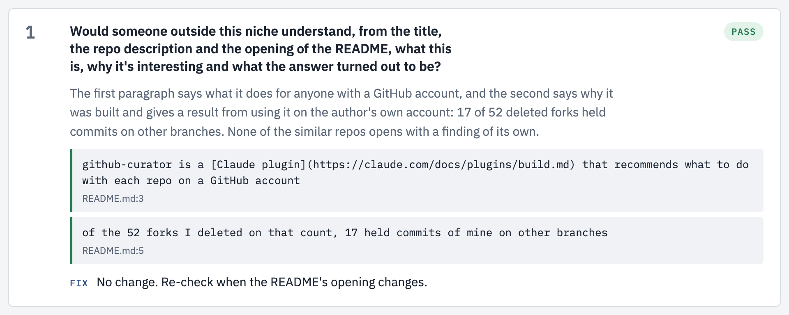

# github-curator

github-curator is a [Claude plugin](https://claude.com/docs/plugins/build.md) that recommends what to do with each repo on a GitHub account: keep it, publish it, archive it, make it private or delete it, and whether to pin it to the profile. Each finding on its scorecard quotes the line it's based on, from a file or the repo's settings, and a script checks every quote from a file against that file. It only recommends; you make the changes.

I built it to sort out my own GitHub account, which had years of forks, experiments and half-finished work on it: to see it the way a potential employer or collaborator meets it, and to find out how far a Claude plugin can go on work whose every claim can be checked. One thing it showed me: my first triages counted a fork's commits on its default branch only, and of the 52 forks I deleted on that count, 17 held commits of mine on other branches, such as `develop`. GitHub keeps a deleted fork's commits with the original project, where they can still be fetched by hash, and the review now counts every branch. The figures are in `docs/github-facts.md` in its repository.

<picture>
  <source media="(prefers-color-scheme: dark)" srcset="https://github.com/tcrossland/github-curator/raw/main/docs/images/scorecard-finding-dark.png">
  
</picture>

It holds five skills, each a set of instructions Claude follows when you run its command:

- [`repo-review`](skills/repo-review/SKILL.md): recommends what to do with a repo and the work worth doing first, finds similar repos, checks the repo or a README draft against seven questions, and publishes a scorecard to a page in your claude.ai account (an artifact, private until you share it), with a fix prompt to paste into Claude Code. It runs in these modes:
  - `repo-review` with a repo (its URL or `OWNER/REPO`), a local clone's folder, a file or pasted text: one full review.
  - `repo-review triage`: a quick first pass over all of an account's repos from the API, which settles the clear deletes and names the repos worth a full review. `triage org:NAME` does the same for an organisation's repos.
  - `repo-review portfolio`: a full review of each repo you name, or of all yours, ranked, with the ones to pin. It was called `overview`, which still works.
  - `repo-review quick`: an at-a-glance review of all your repos, or the ones you name, on three of the questions, from GitHub's search and each README; much faster than a full review, and its calls are provisional.
  - `no-publish`, in any mode: saves the page as a file rather than publishing it.

  How the modes hand on to each other:

  ```mermaid
  ---
  config:
    layout: elk
  ---
  flowchart LR
      triage["triage<br>every repo, forks included"] -- "next: the repos to review" --> portfolio
      quick["quick<br>your own repos, three questions"] -- "next: the repos with a fail or flag" --> portfolio
      portfolio["portfolio URL ...<br>a full review of each, ranked"] --> review["full review<br>and its scorecard"]
      single["repo-review URL"] --> review
      stargazers --> review
      forks --> review
      traffic -- "Traffic history page" --> review
  ```

  Triage and quick review each end with a `next` command that passes the repos worth a full review to `portfolio`; triage settles the clear deletes on its own. `stargazers`, `forks` and `traffic` feed the scorecard's Outcomes panel.

  The seven questions, most important first, each marked pass, fail or flagged:
  - **Hook**: would someone outside the niche understand what it is, why it's interesting and what it found?
  - **Findable**: is it public, with a description and topics in the words people search for?
  - **Facts**: does every result, status, version, command, link and tag match its source?
  - **Defensible**: does each strong claim point to the test, report or file that proves it?
  - **Context**: are the field's terms defined or linked where they first appear?
  - **Way in**: can a visitor run it, reuse part of it or join in, under a licence that lets them?
  - **Tone**: does it read as finished work that shows the author's judgement, rather than internal notes?
- [`stargazers`](skills/stargazers/SKILL.md): lists who starred a repo (its URL or `OWNER/REPO`) and when, and picks out the stargazers whose own work is in the same field. With no repo given it covers every public repo of yours that has stars; `since:YYYY-MM-DD` keeps only recent stars, and `all` reads every stargazer, not only the 30 most recent. GitHub lists stargazers only to a repo's owner, so it works on your own repos. The repo review runs its Steps 1 to 3 for the scorecard's Outcomes panel.
- [`forks`](skills/forks/SKILL.md): lists the forks of a repo (its URL or `OWNER/REPO`) that hold commits of their own, on any branch, what those commits change and who made them, and picks out the ones worth a look, such as a fork that fixes something the repo still gets wrong. With no repo given it covers every public repo of yours that has forks; `all` reads every fork pushed to since it was made, not only the 30 most recent. The repo review runs its Steps 1 to 3 for the scorecard's Outcomes panel.
- [`contributions`](skills/contributions/SKILL.md): lists your merged pull requests to repos you don't own, in three groups: your own organisations' (counted; `orgs:ORG` adds one it misses), your employers' (listed apart, once you name them with `employers:OWNER`) and other people's projects, one row per repo with its stars, the dates and what you did. Pull requests to private repos are counted, never named.
- [`traffic`](skills/traffic/SKILL.md): saves the views, clones, stars and top referrers of every public repo you own to a page titled "Traffic history", which charts them. GitHub keeps traffic for 14 days only, so run it once a week; `schedule` sets up a weekly task that does. On claude.ai the repos must be attached to the chat with push access first, which it asks for, and a scheduled run reads only those attached in the chat that created it.

All five read GitHub through `gh api`, and `forks` reads the forks' commits with git. Before publishing a private repo, the review also scans its full history for keys and tokens with [betterleaks](https://github.com/betterleaks/betterleaks), if it's installed (`brew install betterleaks`), or on claude.ai fetched into the session's own VM and checked against its release's checksums; it only detects, and never sends a secret anywhere. The skills' instructions rule out following, starring, commenting on or messaging anyone, opening an issue or pull request, and archiving, deleting or changing the visibility of a repo: the review only recommends. Where a step needs one of those, such as deleting the repos a triage marks clear, the page gives you the commands to run yourself.

In a claude.ai chat, GitHub answers only for the repos attached to the chat, so the skills ask you once to attach the ones they need and read public repos with git. An organisation's triage runs only in Claude Code, on your own computer, and the first triage of an account that would need more than 10 approvals to attach repos is better run there too. On claude.ai the review reads the profile's pinned repos from the profile page, which may miss some, and `contributions` can't read your organisations, so its count of private pull requests can be short.

## Try it

It runs in a claude.ai chat or in Claude Code. In Claude Code it reads GitHub with your own `gh`, so sign in first with `gh auth login`. In a claude.ai chat it uses the chat's own access to GitHub, and asks before attaching the repos it needs.

1. Download the zip from the [latest release](https://github.com/tcrossland/github-curator/releases/latest) and upload it to claude.ai: Plugins in the left sidebar > Add > Upload plugin.
2. In a new chat, or a new Claude Code session in the Claude desktop app, which picks up plugins uploaded to claude.ai, review one of your repos:

   ```
   /github-curator:repo-review https://github.com/OWNER/REPO
   ```

   It publishes the scorecard to a page in your claude.ai account and replies in three lines: what to do with the repo, the most important fix, and how many of the seven questions pass, fail or are flagged. On an account with many repos, start with `/github-curator:repo-review triage`.

## Install and update

To update, upload the new release's zip the same way; claude.ai asks you to confirm before it replaces the version you have. A Claude Code session that was already open keeps the version it started with, even after the new one reaches its disk: a skill invoked again returns the text it loaded first. Start a new session to use the new version.

The skills run as `/github-curator:repo-review`, `/github-curator:stargazers`, `/github-curator:forks`, `/github-curator:contributions` and `/github-curator:traffic`.

## Working on it

It doesn't take outside contributions yet: `CONTRIBUTING.md` in its repository says how to report a problem and how changes are made. Notes for changing the plugin, and how to run its tests, are in `docs/README.md` in its repository. They don't ship in the zip.

## Licence

Apache License 2.0: see [LICENSE](LICENSE) and [NOTICE](NOTICE).
