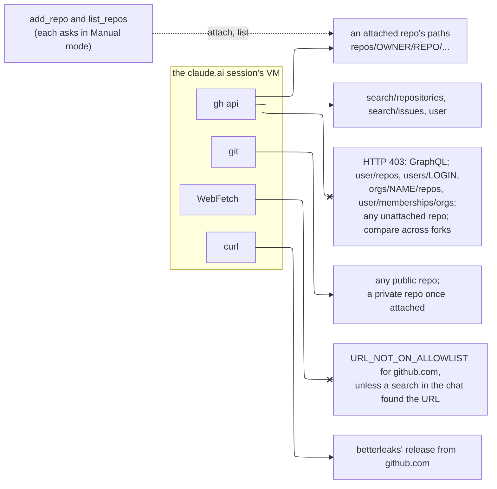
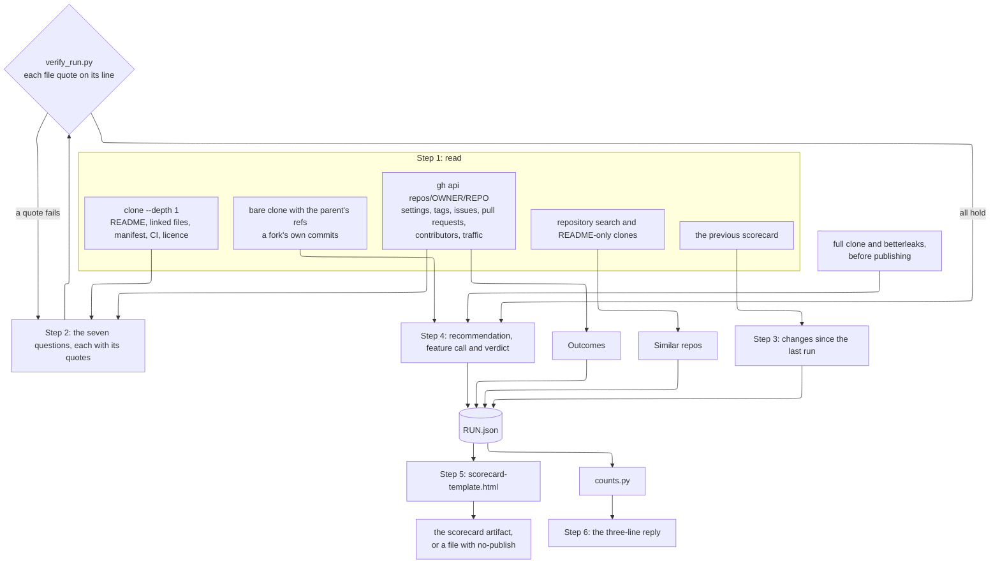

# Design notes

Why the skills work the way they do. `SKILL.md` holds instructions only, because everything in it loads on every run; the reasons live here. Read this before changing a rule, so a change doesn't quietly undo one of these choices.

## The review only recommends

Neither skill archives, unarchives, deletes, pins, closes an issue or pull request, or changes a repo's visibility. Each of those changes what other people see or loses something (stars, watchers, read-only history), so each is the user's call. Where a step is mechanical, the review hands the user the command: the triage page lists `gh repo delete OWNER/REPO` without `--yes`, so each one still asks for confirmation.

## The seven questions, and what isn't scored

The seven questions judge the page as a visitor meets it, in order of importance, with Hook first. They have three statuses and no numbers: a threshold would invite gaming the score instead of fixing the page.

Each label says what it checks to someone who hasn't read the rules. Questions 4 to 6 were Defensible, Context and Way in until 0.7, which named a quality or a metaphor rather than the check, so they're now Evidence, Jargon and Getting started. Old scorecards keep their labels, since the page shows each question's `short` from its own data, and a re-run matches questions with the previous run by their order, not their label.

Outcomes (stars, traffic, stargazers) and similar repos are context. They never change a status or the verdict: there's no bar a repo should reach, and a niche repo can be excellent with few stars.

A private repo is checked as it would read once public. Findable is flagged rather than failed when visibility is its only gap, because making it public is a decision, not a defect.

A description the review suggests is kept to GitHub's limit of 350 characters (`docs/github-facts.md`). The first review to suggest copying a manifest's description to the repo gave a command GitHub refused, since the manifest's ran to 462 characters, and a manifest's description has no reason to stay that short. The skill has Claude count the characters with code, as it recounts the numbers in its own prose, since a count by eye is unreliable at this length.

## The recommendation

There are five actions, one per repo: keep, publish, archive, make-private and delete. The tie-breaker is "prefer the action that loses least": archive over make-private when anyone else has starred, forked or opened an issue, and make-private over delete whenever anything of the user's is in the repo.

A private repo can be kept or made private, and the two used to blur: on 2026-11-21 a make-private review of a private repo read the action as "leave it private", and on 2026-11-22 a quick review, finding no action for a private repo not worth showing, gave keep and asked whether it stays private. So make-private on a private repo means leaving it private for good, and keep means it stays private only until it's ready to publish, which is the difference the user acts on.

For make-private and delete the page isn't worth fixing, so the verdict's fix is the action, or the first thing to do before it, and comes from no question. The verdict used to need a question's number all the same, and the page showed "Most important fix · question N": reviews filled it each by its own reasoning, a make-private review with 6 and a delete review with 1. Now `question` is empty for those, and when everything passes, and the page shows no number.

The checklist before archiving comes from the work done on a real project before it was archived. A finished project archived with a proper account of what it was, why it stopped and what the author would do differently is a stronger portfolio piece than an unexplained abandoned repo.

## A scanner for secrets before publishing

Reading `git log` for secrets is weak over a long history, so the check before publishing runs a scanner. Of the scanners compared on 2026-11-20, betterleaks and gitleaks both scan the full history locally under MIT; betterleaks is maintained by gitleaks's original author and was the user's pick. trufflehog is AGPL-3.0, and GitGuardian's ggshield sends the code to its service. Calling a tool installed on the user's machine isn't bundling it, but a copyleft tool still wasn't wanted.

- **Detection only.** Both major versions can send each secret found to its provider to test it. That would send the user's secrets to third parties from a review that only recommends, so the script never asks for it, and with v2 turns it off explicitly, since an environment variable can turn it on.
- **Both versions.** Homebrew installs v1 while v2 is a release candidate with other flags and another report format. The script picks by `betterleaks version` and one `jq` reads both reports, so a user on either gets the scan.
- **Redacted, and never copied.** The report holds no secret values, and the review never copies one into the scorecard, the fix prompt or the reply, which are published or pasted elsewhere.
- **Findings stay out of the fix prompt.** Removing a secret from the history means rewriting it, which a commit can't do, and the key has to be revoked at its provider first. Both are the user's.
- **No install on the user's computer.** The review doesn't install software there. Without betterleaks it searches the history as before, marks the item `todo` and says the scan didn't run, so a missing scan never passes silently.
- **A fetch on claude.ai.** There the clone is in the session's own VM, which has no betterleaks but may download it, and which nothing else uses. So the review fetches the release it was checked with (1.10.1, the stable one) into a folder of its own there, and runs it only if it matches the release's `checksums.txt`. The checksums come from the same release, so they catch a broken or swapped download, not a release tampered with at its source; the release's sigstore bundle isn't checked. The fetch refuses to run outside Linux, so it can't land on the user's Mac. Raise the pinned version only after checking the new release's flags and report.

## Feature is separate from the action

Featuring (pinning on the profile) is a yes or no alongside the action, not a sixth action, because the two combine: an archived project can still be one of the best pieces on a profile. Pinning is a step towards featuring, not a decision of its own. A profile shows at most six pins, so featuring is a choice made across all of the user's repos, which is why portfolio mode ranks the pins.

## Triage settles only what loses nothing

Triage reads the API alone, so it can't judge a page. It calls a repo `clear` only when deleting it loses nothing of the user's and nothing anyone else uses: an empty repo, or an unchanged fork nobody else has starred, forked or opened an issue on, and that isn't pinned. Everything else gets a provisional action and goes to the full review.

A fork with commits beyond its parent is never clear. A real run showed why: a fork looked like it held nothing of the user's, because GitHub's author filter found none of their commits, yet it held six commits they had made under an email not linked to their account.

## Similar repos

They show what a repo adds, which topics it lacks, and where to point readers of an archived repo. They are described only from what their own pages say, never as copying or influencing one another, the same rule as the `stargazers` skill. GitHub search can't find tools hosted elsewhere, so projects the README names are added by hand.

The user doesn't maintain the similar repos, so they aren't judged: a pass or fail on someone else's page is a verdict the user can't act on. Each is described instead by how it bears on the user's repo, in six answers, each feeding one call about it: Overlap (whether it belongs on the list), Difference (the Hook, and the feature call), Alive and Mention (which tools an archived repo's status section points to or names), Found by (Findable's topics) and Worth borrowing (a fix, only when it fixes a failing or flagged question). The answers are words from fixed lists, not grades, so they can't be read as a score. Difference says only what the user's repo adds: in the first live check, on 2026-11-22, three of five Differences for one repo remarked on the other repo's README instead ("its README is one line naming the paper"), and one listed what the user's repo lacked under the label "This repo adds". Mention follows from how the two repos relate, in a fixed order, rather than from the recommended action: the same check gave all five repos `no` on a keep review, a maintained repo doing the same job among them, because a keep repo has no status section to name them in. Found by counts only words absent from the repo's own description, topics and README opening, since a repo with none of those would otherwise lack every word. The topic search is skipped for a repo with no specific topics, where the same check made topics up and found nothing. They come from the search result and the README opening the panel already reads, so they cost no request and work on claude.ai. "Maintained" means pushed in the last year and not archived: the archive pointer needs a line that a run draws the same way each time, and a year is long enough not to drop a finished tool that is still looked after.

## Most-starred repos in `stargazers`

A stargazer's three most-starred repos say most about their field, but GitHub can't list someone's repos sorted by stars (`docs/github-facts.md`), so the skill reads every page and sorts them itself. That costs one call per 100 repos: one for most people, but tens for an organisation with thousands. Repository search can sort by stars in one call, and works on claude.ai, but its limit is 30 requests a minute, which a run of 30 profiles, each with an organisation, would pass.

## Forks are read with git, from one clone of the repo

`forks` clones the user's repo once, treeless, and fetches each fork's branches into it under `refs/forks/OWNER/`, then lists the commits on them that no branch or tag of the repo holds. One clone serves every fork, and each fetch brings only what that fork adds. It reads every branch, as triage now does for the user's own forks, since a fork's work is often on a branch of its own (the first real run found one fork's only commits on `grails3`). Git also works where the compare API doesn't: on claude.ai it's refused across forks, and the forks themselves can't be attached.

When the user's repo is itself a fork, its parent's branches and tags are fetched into the clone as well: a fork of it that has since pulled in the parent's later commits would otherwise show them as its own.

Only forks pushed to after they were made are read. GitHub's listing gives `created_at` and `pushed_at`, and a fork nobody pushed to holds nothing of its own: in a sample of 20 forks of a repo with 5,606, every fork with commits of its own was pushed to after it was made. The one fork not pushed to that showed a commit beyond the repo held the upstream maintainer's, on a branch the repo has since deleted. That cuts the work to about one fork in seven there, and the 30 most recently pushed are read unless `all` is given, as `stargazers` reads the 30 most recent profiles.

Commits are listed by the author's name and never an email address, since these are other people's, and up to 20 per fork: a fork with thousands most likely carries history from somewhere else, and listing it says nothing.

## Three groups in `contributions`

A merged pull request to someone else's project is evidence someone else's maintainers reviewed and accepted, but not every pull request to a repo the user doesn't own is that. Issue search's `-user:LOGIN` leaves out only the user's own account, so pull requests to the user's own organisations come back too; on the account it was built on they were more than half. Those are counted, not listed. The user's own organisations are the ones they're an admin of, since a membership alone could be an employer's.

An employer's repos can't be told apart from the API: on that account the employer's 72 pull requests went to public repos, so visibility doesn't separate them. So the user names their employers, with `employers:` or in their own instructions or memory, which keeps the names out of the plugin and works on claude.ai, where there's no local file to read. Without them, the reply names the owners with the most merged pull requests and asks. Pull requests to private repos are searched apart (`is:private`) and counted without their names, because a visitor can't see them.

The groups are counted by a script from the search's own results, and its total is checked against the search's `total_count`, for the same reason the review's reply counts come from the page's data: counts made by hand drift. Stars come from one repository search with up to 40 `repo:` qualifiers rather than one call per repo, because `repos/OWNER/REPO` is refused on claude.ai for any repo not attached to the session, while search answers there.

## Other people in the review

Who else built a repo, and whether the people who came to it got an answer, say as much about it as its stars, so the Outcomes panel lists them: Contributors and Waiting on you. Like the rest of the panel they get no pass or fail; they feed Tone, Getting started and the fix prompt instead.

Contributors come from the commits API rather than `git shortlog` on the clone: a public repo is cloned with `--depth 1`, which holds one commit, and the API gives each commit's login where GitHub links one, so a person is named by login and otherwise by the name on their commits, never by email address. A commit with no login counts as the user's when its name appears on any commit carrying the user's login: on the account it was built on, one repo had 8 of its 17 commits under the user's name with no linked login, and a rule that counted only logins would have listed the user as a contributor to their own repo. A script groups them, as the reply counts are, so the numbers on the page aren't counted by hand. The House style's check on whose work it is, before writing a history in the first person, reads the same list: it used to say `git shortlog -sn`, which on the `--depth 1` clone counted one commit, as two reviews in the live check of 2026-11-22 found.

Tone is flagged, not failed, for shared work presented as the user's alone, because how much credit a contribution needs is a judgement the user makes; the fix names the others so the change is easy. Whether a repo takes contributions is a flag on Getting started for the same reason, and it's met by saying either way: a repo that doesn't want them is fine once it says so.

The fix prompt drafts a reply to each issue or pull request waiting on the user, under its own status (`reply`), so the page's filter can show the replies apart from the edits. The review never posts one, and the prompt tells Claude Code not to either: a reply speaks for the user, so it's theirs to post, edit or drop.

## Quick mode

Full reviews take two or three minutes a repo, and a portfolio run over many repos takes as long again for each, while triage only sorts. Quick mode is the at-a-glance review between them: it answers Hook, Findable and Getting started for each repo from GitHub's repository search and the README alone, on one page with a row per repo. Those three are the questions a search result and a README can settle: the search item carries `description`, `topics` and `license` (`docs/github-facts.md`), and the README comes from the clone that checks out nothing else. The other four need the files behind the page (Facts, Evidence), a reading of the field (Jargon) or the page's whole voice and its contributors (Tone). Getting started leaves out whether the repo wants contributions, which needs its settings and issues.

- **One search, no attaching.** The listing comes from repository search, with `archived:false` and without `fork:true`, which gives every field needed for all the user's own repos in one call, private ones included, and answers on claude.ai with nothing attached. Only a private repo's README needs attaching there, as in triage. Forks are left out: their README is mostly their parent's, and triage sorts them.
- **Provisional, and its own page.** Its statuses and actions are provisional, as triage's are, and it makes no feature call, which needs Evidence and Tone. It publishes to a "Quick review" page and never to a repo's scorecard, so a quick run can't replace a full review's page. Its `next` command hands the repos with a fail or flag to `portfolio`.
- **Quotes are still checked.** Each status carries a quote, and the quote checker runs against each repo's README clone, since an at-a-glance page that misquotes is worse than none. The checker skips quotes from a repo's description, and in the first live check two of those, typed rather than copied, were wrong, so the search listing is saved to a file and a second check matches each description quote against it.
- **Fail or flag, as the full review.** In the first live check the one disagreement with a full review was Getting started for a repo with a licence and no word on how to use it: the quick run flagged it and the full review failed it. Getting started asks whether the page tells a visitor how, so a README that doesn't fails it, in both. A description without topics, or the reverse, is flagged: part of Findable is met.
- **Left out.** The profile README repo (`OWNER/OWNER`) is the profile's page, not a project, so Findable and Getting started don't apply to it. The `next` command leaves out repos whose likely action is make-private or delete, since a full review of a repo not worth showing is time spent on nothing the user will publish.
- **What it costs.** In the first live check, on 2026-11-22 in Claude Code, a quick review of 17 repos took 229 s, 13.5 s a repo, where full reviews of two of them took 324 s and 331 s. It agreed with those two on five of six statuses and on both actions. The reply's counts come from the counts script, which checks that every repo has the three questions in order.

## Steps for one mode live in their own file

`SKILL.md` loads in full on every run, so a single review used to carry the portfolio and triage steps it never runs. Those steps are in `portfolio.md`, `triage.md` and `quick.md` beside it, read only in their mode, so a single review loads the shared rules and Steps 1 to 6, and changes to triage don't grow every review. A portfolio run reads its file before starting, since it holds how a portfolio run logs its time, not only Step 7. Each mode file names the sections of `SKILL.md` it relies on.

The quote checker is a file, `verify_run.py`, copied into the working folder the way the template is, so it's run as written rather than retyped from the page. The supporting files load on claude.ai by the same route as the template, which was seen to work there (`docs/github-facts.md`); a script copied that way has been seen to run in Claude Code, and a single review there left the mode files unopened, but it hasn't been tried on claude.ai yet.

## One list of Claude Code's tools

The steps name claude.ai's tools (`add_repo`, `list_repos`, `list_artifacts` and the rest), because claude.ai is where the GitHub access is narrowest and the steps were written around it. Claude Code has none of those names, and a run there had to guess. `SKILL.md` maps each one to what Claude Code uses in one list near the top, rather than at each step, so the steps read the same on both and the mapping can be checked in one place. Without an artifact tool the run falls back to `no-publish`, since a page saved as a file loses nothing and the reply can say so. That fallback is what a terminal session gets: Claude Code outside the desktop app has no artifact tool (`docs/github-facts.md`).

GraphQL is named once, in Step 1's pins, with where it works and where it's refused. Before, the settings bullet said it wasn't available at all, which was true only on claude.ai, and the next bullet used it.

## Routes that work on claude.ai too

A claude.ai session's `gh` is bound to the repos attached to it (`docs/github-facts.md`): GraphQL, every path not scoped to an attached repo, and compare across forks are refused, while git clones any public repo and issue and repository search answer. In the 0.2.4 test runs that left triage marking no repo clear and stargazers reading no profile. The skills now take routes that work in both places where one exists, rather than one route per place, so a rule tried in Claude Code holds on claude.ai.

In a claude.ai session as checked up to 2026-11-22 (each route with its source and date in `docs/github-facts.md`):

- **A fork's commits beyond its parent** come from a clone of the fork without trees or files, with every branch and tag of the parent fetched into it, then `git rev-list --count` and `git log` on every branch of the fork against them. The compare API is refused across forks on claude.ai, and lists at most 250 commits anyway. The clone costs the parent's commit history: 24 MB and a few seconds for erlang/otp, through claude.ai's proxy as in Claude Code, and about the same with its 30 branches and 576 tags as with its default branch alone. A clone left from an earlier run is fetched again rather than reused, since a stale count could mark a fork clear.
- **Every branch counts**, not the default branch alone. The first triages counted from `HEAD`, and 12 forks marked clear on that count turned out to hold the user's commits on other branches (`develop`, `grails-2.5`, a GitHub web edit's `patch-1`), which they found only after deleting them. The parent's tags count as well as its branches, so a fork's copy of an upstream release branch that the parent has since deleted holds nothing beyond it once the release was tagged. Nothing is read from the parent's default branch, so nothing about the parent needs the API, and no branch name goes through the shell, where zsh had read part of one as a modifier.
- **Whose commits they are** is judged by the author's name, because git carries no logins. The old rule counted a commit with no login as possibly the user's, because GitHub's author filter missed commits made under an email not linked to their account (Triage settles only what loses nothing, above); judging by name keeps that, and the email's domain, never the address, still lets the user recognise a former employer's.
- **A README's opening** comes from a clone that checks out only the README, for the exact text, which WebFetch rewords and cuts. It looks where GitHub does, `.github/`, then the top level, then `docs/`, and takes the shortest name in each, so `README.md` comes before `README.ja.md`.
- **A fork's parent** is given only by `repos/OWNER/FORK`, which on claude.ai needs the fork attached. A parent doesn't change, so the triage page records each fork's, and the next triage reads it from there and attaches only the forks new since. Its branches can change, so they're fetched each time rather than recorded.
- **Attaching** goes through Manual mode. Auto mode's check refused `add_repo` in some chats and not in others with the same permission in the request; in Manual mode the chat asks the user before each call, and the call then attached. Triage asks once, up front, for every repo it needs attached, but Manual mode still asks before each call, so attaching N repos takes N approvals. A first triage, with no page to read parents from, needs every fork and private repo (72 on the account it was built on), so past 10 approvals it suggests running the first triage from Claude Code, which attaches nothing. Both write the same page, so later triages on claude.ai read the parents from it and attach only new forks and the private repos. A repo that isn't attached goes to review, like any repo whose parent or commits couldn't be read: triage settles only what it can see loses nothing.
- **The listing's fields** on claude.ai come from one repository search, since `list_repos` gives no stars, size or licence. Search leaves forks out unless asked, hence `fork:true`.
- **Pull requests to the parents** come from one search over all the user's pull requests to other people's repos, rather than one per fork. The search API allows 30 requests a minute, which an account with more than 30 forks with commits would pass; one search of 100 a page stays well under it, up to search's own cap of 1000 results. `-user:OWNER` leaves out only the user's own account, and a fork's parent is never in it.
- **An organisation's triage** stays in Claude Code: on claude.ai `orgs/NAME/repos` is refused, and nothing there gives the user's admin rights, which decide what triage may call clear.
- **Stargazers' profiles** come from the profile page by WebFetch when `users/LOGIN` is refused. It's a summary, labelled as one, and gives no latest activity or most-starred repos, so the pinned repos' descriptions stand in for the field. When no profile could be read, the review's list says "Not available" with the reason: "None in the same field" there would report a judgement never made. A repo no one else has starred has one line for both lists, "None: no stargazers besides you", since reviews left to word it themselves wrote three different lines for that case on 2026-11-21.

The claude.ai GitHub connector isn't one of those routes. In Claude Code it reads any public repo as the user, but in a claude.ai chat, the one place a route around attaching would help, only its tools without an `owner` parameter answered (its own profile and search), and `gh` already reaches those there (`docs/github-facts.md`). It also can't see private repos, has none of stargazers, traffic, forks or pins, returns authors' email addresses and can write. So no skill uses it. Worth checking again if its repo tools start answering in a claude.ai chat: it would then read forks' parents and other owners' repos without attaching them.

## How one review flows

A full review of a repo reads from five places, writes one JSON file, and builds both the page and the reply from it, so the two can't disagree. Each quote is checked against the file it names before the recommendation is made (the run's JSON starts with the questions alone for that check), and a failed check sends the question back to be rewritten.

Outcomes and Similar repos are context: they reach the page but never a status or the verdict (The seven questions, above).

## The scorecard page

The page is one template, `skills/repo-review/scorecard-template.html`, filled with the run's JSON. It renders all four modes: a single review, the portfolio page, triage and the quick review. It's a separate file so it isn't retyped on every run. A re-run republishes to the same artifact, so the page keeps one URL and can show what changed since the last check. Scorecards published before the skill was renamed have the title "Portfolio repo check: …", and re-runs still find them.

A single review's page puts the decisions first and the evidence behind them later: the recommendation, the most important fix, the questions' strip and then the fix prompt, which is what most visits come for. The sections a visit reads only to check a call start closed, each with a summary that says what's inside: the changes since the last check, the recommendation's signals, its before-lists (with how many items are to do), the Outcomes panel and Similar repos. Before, the fix prompt came after Outcomes and Similar repos, more than a screen below the fix it carries out. The question rows stay open, since they hold the quotes the page stands on, and the strip links to each one.

## Timing

Every page carries the time and the GitHub requests each step took, so a change made to speed a mode up can be measured. The times are wall-clock from the end of one step to the end of the next, so they include Claude's own work between tool calls. That's what the user waits for, but it can't be told apart from time spent waiting on GitHub, and a skill can't read its own token use.

The request count comes from the rate limit's `core.used`, read at each step's end, rather than from Claude counting its own calls: reading the rate limit costs no request, and it counts every page of a paginated call, which a count of commands would miss. Search requests have their own count in the rate limit, but it resets every minute, so it can't be read across a step; those are counted by hand. GraphQL has its own limit, so it isn't counted. Traffic requests don't raise `core.used` at all (`docs/github-facts.md`); a review always makes the same four, so the skill names the gap rather than adding a hand count for it. Every timing line runs in one shell, so the log has one file and one clock. A step that spans GitHub's hourly reset has no count. Reads of the rate limit can also disagree within one window (`docs/github-facts.md`): resets a second apart, and now and then a read from what looks like a fresh window. So the conversion takes resets up to a minute apart as one window: a real reset starts a new hour-long window after the old one ends, so it moves the reset on by an hour or more. It gives no count across a read whose `used` falls. A stray read then costs the two rows either side of it, as a failed read does, and a review's total, from its first and last lines, still holds. Anything else using the same GitHub account at the same time inflates the count: a claude.ai session and the user's own `gh` were seen sharing one count. The logging line keeps `gh`'s output only when the call succeeds, because on an HTTP error `gh` prints the error body to stdout, and the conversion skips any line it can't read.

Each step's line goes in a command of its own. A line is stamped when its command runs, and Claude writes a whole command before it runs, so anything written into the same command as the line is timed to the step the line closes. In the cold overview of 2026-11-20, one command wrote the `Compare` line and then the whole page's JSON, so `Compare` took 35 s and the two steps after it 1 s each. A separate command costs one more tool call per step, a few seconds in a run of several minutes, and keeps each step's time its own.

Timing lists the work each step holds, not only the step's name. On 2026-11-21, in three of eight reviews run as subagents and again in two on 0.4.0, work landed before the line of the step it belongs to although each line had a command of its own: the JSON started and the quote check run before `Questions`, the previous scorecard looked for after `Get the draft`, Step 5's JSON written before `Verify and recommend`, `Questions` logged before the questions were answered, and one `Compare` line appended in the command that wrote the comparison list. Each was a boundary the step's name left open, so the list names the work on each side of it, and the rule on the logging command names the joins (`&&`, `;`, a newline) that had been used to bundle it.

A run prints one line of progress as each step starts, and a portfolio run one as each repo starts, since a full review takes two to five minutes and a portfolio run of ten repos about half an hour, with only tool calls to watch. The line is plain text rather than a command, so it costs no tool call and adds no time a timing row could show. It names the step as the log does, so what the user saw matches the page's rows. A skipped step keeps the others' numbers, since the run doesn't know at the start which steps will run.

The quote checker reads the questions from the run's JSON, so Step 4 starts the JSON with them and Step 5 adds the rest. `Verify and recommend` includes writing the questions, and `Build` the rest. Before, Timing said `Build` wrote the JSON while Step 4 already needed it, so where the writing was timed depended on how a run read the two.

A portfolio run reviews its repos one at a time. Each log line closes a step that began at the line before it, and the request count is the account's, so two reviews run side by side can't be told apart: in the first overview logged, two repos' steps were interleaved, and each review's rows took in the other's work, while the overview's own rows gave one repo 356 s and the other 1 s. Running them in turn costs little extra time, since a run's time goes mostly to Claude's own work rather than to waiting on GitHub, and it keeps each repo's rows and the portfolio page's per-repo times true.

## Where the fix prompt's edits land

The fix prompt follows the repo's own rules on branches first, and the user's instructions over both. Without either, a public repo, or one others commit to, gets a branch and a pull request, because its main branch is what visitors and contributors see. A private repo only the user commits to gets commits on the current branch, left unpushed: a pull request there is a review step for an audience of one, and the unpushed commits give the user the same chance to review.

## One fix prompt per repo on the portfolio page

The portfolio page carries each repo's fix prompt as its scorecard has it, with a copy button on that repo's row, so acting on it doesn't mean opening every scorecard. Each prompt stays separate, and copies the same text as the scorecard's "All": a fix prompt's edits, branch and checks belong to one repo, and Claude Code runs it in a session in that repo, so one prompt for several repos would have nowhere to run. The page builds the text with the scorecard's own function, so the two can't drift apart.

## Arguments are keywords, not placeholders

Several repo URLs with no mode word name no mode. On 2026-11-21 ten URLs given that way ran as ten separate one-draft reviews in subagents, side by side, which `portfolio` exists to avoid. A quick review and a portfolio review are both fair readings, at very different costs (13.5 s a repo against two or three minutes), so the skill asks, offering quick first since it's the cheaper look and names the repos worth the full one. Without anyone to ask it runs quick, the reading that costs least if it's wrong.

A bare `repo-review` is the same case with less to go on, so it asks too, offering the three ways in a user without a URL to hand most likely wants. The repo in the current folder comes first when there is one: in Claude Code the session usually starts in the repo the user is working on, and that review is the pre-push check. Then quick and triage, which need no list of repos. With no one to ask it runs quick, for the same reason as above. A portfolio run isn't offered: with no repos named it reviews every one in full, which is the run to choose deliberately, after a quick review or triage has named the repos worth it.

Each skill reads its arguments as words (`portfolio`, `triage forks`, `org:NAME`, `since:2026-01-01`, `no-publish`) rather than through Claude Code's positional placeholders (`$0`, `$name`). The modes take lists of any length, and a draft can be pasted text with spaces, so a fixed position for each argument would misread most calls. The `argument-hint` in each skill's frontmatter shows the words in Claude Code's autocomplete.

The names say what a mode costs and what it's for. Portfolio mode was called `overview`, which sounds lighter than `quick` though it's the costliest mode, a full review of every repo then a ranking; it's named after the page it publishes, and `overview` still runs it, so commands saved from older pages keep working. `contributions` took the user's organisations as `own:ORG`, while `own` in `triage own` means repos that aren't forks, so it takes `orgs:ORG`, with `own:` still read. Every skill that takes a repo takes its URL or `OWNER/REPO`, the form `gh` and GitHub's search use. In `repo-review`, `OWNER/REPO` could also be a relative path, so an existing folder or file of that name is read as one.

Claude Code still fills those placeholders wherever they appear in `SKILL.md`, code blocks included (`docs/github-facts.md`), so no `SKILL.md` holds a `$` before a digit or `ARGUMENTS`, and none declares `arguments` in its frontmatter, which would make names such as `$email` placeholders too. Claude Code's docs give `\$0` as an escape, but a claude.ai run may not strip the backslash, so the commands avoid the form instead: `sed` in place of awk where a field number was needed, and a named awk variable (`$email`) where awk stays. A test fails on any that come back.

An organisation's triage is stricter than the user's own. Other people may rely on an organisation's repos, and only its admins can archive or delete them, so an unchanged fork there goes to review instead of being a clear delete, and a repo the user isn't an admin of is marked as an admin's call. Its page has its own title, so it doesn't replace the triage of the user's own repos.

`no-publish` exists for working on the skill: a test run of a changed rule or template would otherwise republish the live scorecard.

## Reply counts come from the page's data

The reply's pass, fail and flagged counts are printed by a script from the page's JSON, not counted by Claude. Counted by hand they drifted: one review's reply said 2 pass, 0 fail, 5 flagged where its scorecard had 0, 5 and 2. The script reads the same data the scorecard renders, so the two can't disagree, and it refuses to count when there aren't seven questions or a status is unknown, since a wrong count is worse than none.

## Behaviour evals

The unit tests run the skills' code; they can't notice a rule change that flips a recommendation. The cases in `evals/` do: each gives one repo and the call the skill should make, for a rule that has gone wrong or nearly so in a real run, and each should fail when its rule is cut from the skill. `scripts/evals.sh` runs them with `claude plugin eval`, which also runs each case without the plugin, so the report shows how much of each call comes from the skill rather than from Claude's own sense.

The cases run offline. The eval refuses reads outside a run's workspace, the skill's own mode files included, so `scripts/evals.sh` grants Read on the plugin's `skills/` folder. A case's prompt holds everything `gh` and a clone would return, and tells Claude not to call them: the eval gives each run an empty workspace with no shell unless granted one, and a live repo would change under the case. The prompt asks for the calls as a JSON block, which `regex` graders check, rather than an `llm` judge reading the reply: the expected call is a fixed word, and a regex gives the same verdict every time. A grader checks for something present, never only for something absent: a run without the plugin writes no such JSON, so "no `todo` anywhere" passed it for free and made the plugin's gain look smaller than it was. A check that something is absent matches the JSON it would be absent from, with a lookahead.

Each case was tried with its rule cut out of the skill, and the run without the plugin is the same check taken to the limit. On 2026-11-20 every case failed all three runs without the plugin, though for the triage cases that's partly vocabulary: without the skill there's no `clear` or `review` to use. Cutting one rule's text made two cases fail: the unchanged fork's clause in triage's clear delete, and the whole licence rule for Getting started (cutting only "names a licence that no file holds" wasn't enough, since the fixture has no licence file at all, which the rest of the rule covers). Three cases still passed, because the skill states their rule more than once: the private Findable rule in three places, and forks with commits are kept from clear both by the definition of clear and by counting commits with no login as possibly the user's. The archived repo's items stayed done with the "says plainly that it no longer runs" clause cut. A cut that leaves a case passing shows the call is held by more than one statement, so a change has to remove every one of them to flip it. The two cases added for quick mode and Similar repos on 2026-11-22 were tried the same way, one run each: cutting Difference's rule failed both its graders, but cutting quick mode's Getting started sentence or Mention's order left those graders passing, so they don't yet show their rules are what holds the call.

A run reads the skill as a user's would, so it costs a review's tokens; the suite isn't part of the unit tests. A change to a rule runs only the cases that guard it, once each and without the runs without the plugin, and every case runs once before each release, the Getting started case three times. A user only gets a change with a release, so that run catches a rule change that breaks another case before it ships, at the cost of finding out later than the commit. The repeat runs and the runs without the plugin answer questions about the version being shipped (does a call hold steady, how much of it comes from the skill), not about one commit, and cost four times as much: about $13 for the full suite of 7 cases on Opus 5.5, against $3 for every case once. While the plugin's only user is its author, a release can do without those answers, so the full suite runs only when a case is added, where the run without the plugin shows the case measures the skill, and returns before each release once someone else installs the plugin. A rewrite of text every case reads runs every case once, since any call could shift. The Getting started case runs three times and needs every run to pass, because in the 0.2.4 test runs one repo's Getting started was flagged in one review and passed in the next on the same commit: a rule that leaves too much to judgement shows up as runs that disagree.

The suite says which model a skill needs. On 2026-11-22, with `--model sonnet`, every case passed three runs out of three but one: `other-people` missed Tone's flag once, as it did once on 2026-11-21 on Opus 5.5, so Tone is the call that varies between runs on either model. The Sonnet runs cost about half as much each as Opus 5.5's ($6.23 for 27) and took longer (23 to 145 s a run, four at a time, against 13 to 124 s). So the cases give no reason to prefer the costlier model for any skill; they don't cover the judgement calls that most need it, Hook, Evidence and Jargon on a real README, which only a full review of a real repo shows.

## Traffic keeps one document per snapshot

GitHub serves 14 days of traffic, so a history has to be saved before each day drops out. `traffic` saves what GitHub holds into the database of a page, as one document per snapshot, and the page merges them, a later snapshot winning for a day both hold, since the last day of a snapshot is partial. A run then only ever creates a document. Keeping one document per repo instead would mean reading it back and merging on every run: the database refuses a write to an existing document without the version last read, and its export saves a document's body without that version, so the merge would carry the run's whole history through the conversation. A snapshot of 74 repos is about 19 KB, because each repo keeps the first and last day GitHub gave and only the days with traffic: the database takes 256 KiB per document and 25,000 documents, so a weekly snapshot fits for an account with several hundred repos and for centuries.

The page holds no data of its own, so a run needn't republish it. It carries a version in a `<meta>` tag, and a run republishes it only when the skill's copy is newer, so a fix to the page reaches it on the next run.

The charts start at the latest first day in the first snapshot. GitHub's 14 days end earlier for a repo with no recent traffic, so before that day only some repos are held, and a total across them would fall for want of data rather than visitors. Unique visitors and cloners are kept but not shown: GitHub's daily uniques can't be added across days.

It covers the user's public repos, forks included, as the hand snapshots before it did, because traffic for private repos needs a paid plan. On claude.ai a repo's traffic needs it attached with push access, and a scheduled run can't attach, so `schedule` attaches them in the chat that creates the task.

## What ships

Everyone a plugin is shared with receives every file in the upload. `scripts/package.sh` zips only the manifest, the skills, the README, the changelog and the licence (`LICENSE` and `NOTICE`), leaving out `docs/`, `tests/` and `scripts/`, which are for working on the plugin, not using it. The README ships, so it links only to files the zip holds, and the notes for working on the plugin are in `docs/README.md` instead; `tests/test_shipped_links.py` checks every relative link in a shipped file.

The changelog ships because the zip is all a user gets: the repo is private, and the commit history, written for working on the plugin, doesn't go in it. Each entry says what changed from the user's side, and is written in the same commit as the version it describes.
