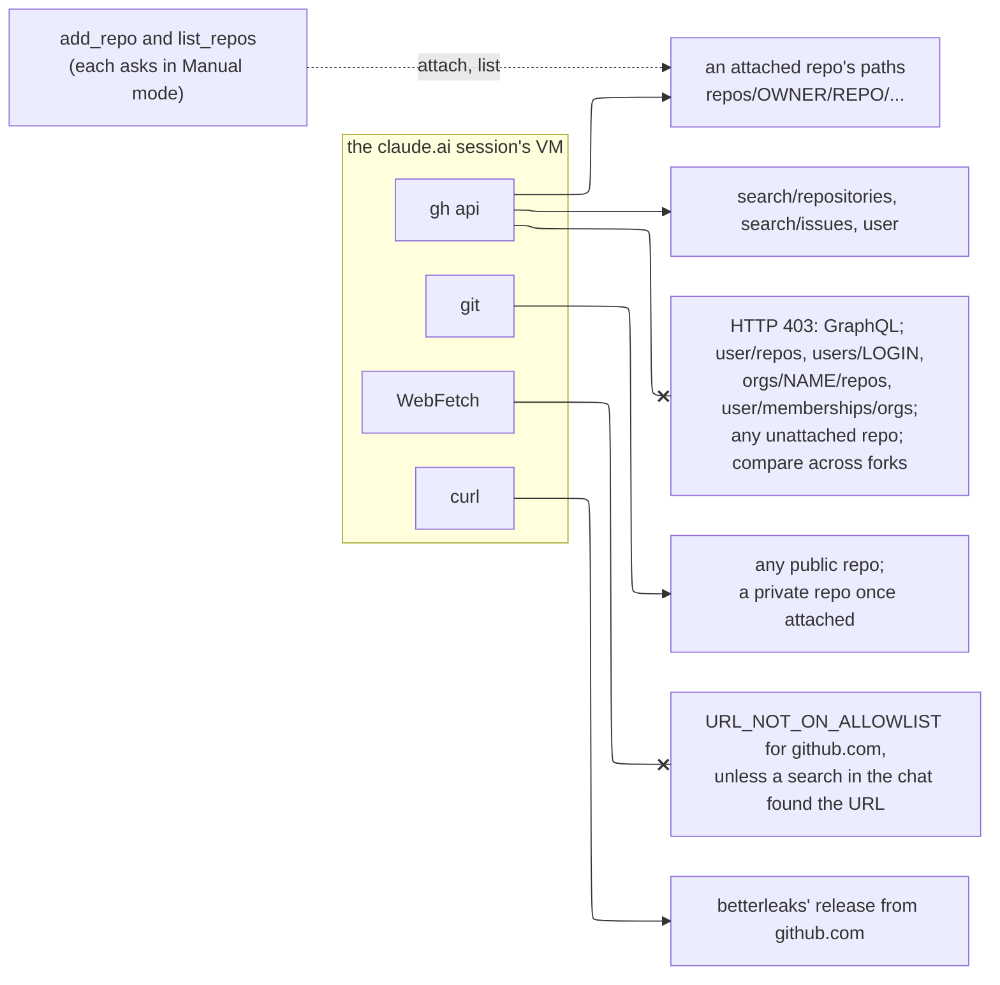

# Facts the skills rely on

The behaviours of GitHub and of Claude's plugin system that the skills state or depend on. Each fact has its source and the date it was checked. Platform behaviour changes, so recheck a fact before relying on it in a new rule, and update its date when you do.

"Seen" means it was seen in a real call rather than read in documentation.

## Repo actions

| Fact | Source | Checked |
|---|---|---|
| Changing visibility, in either direction, erases a repo's stars and watchers. | [Setting repository visibility](https://docs.github.com/en/repositories/managing-your-repositorys-settings-and-features/managing-repository-settings/setting-repository-visibility) | 2026-11-19 |
| Making a public repo private detaches its public forks, which stay public. | Same page | 2026-11-19 |
| Archiving makes issues, pull requests, comments, code, releases and more read-only. GitHub recommends closing issues and pull requests, and updating the README and description, first. Unarchiving is possible. | [Archiving repositories](https://docs.github.com/en/repositories/archiving-a-github-repository/archiving-repositories) | 2026-11-19 |
| A deleted repo can be restored within 90 days, unless it was part of a fork network that isn't empty. | [Restoring a deleted repository](https://docs.github.com/en/repositories/creating-and-managing-repositories/restoring-a-deleted-repository) | 2026-11-19 |
| Deleting a public repo doesn't delete its forks. Deleting a private repo deletes its forks. | [Deleting a repository](https://docs.github.com/en/repositories/creating-and-managing-repositories/deleting-a-repository) | 2026-11-19 |
| `gh repo delete OWNER/REPO` asks for confirmation unless given `--yes`, and needs the `delete_repo` scope (`gh auth refresh -s delete_repo`). | `gh repo delete --help`, gh 2.105.0 | 2026-11-19 |

## Profile pins

| Fact | Source | Checked |
|---|---|---|
| A profile shows up to six pinned repositories and gists, combined. | [Pinning items to your profile](https://docs.github.com/en/account-and-profile/setting-up-and-managing-your-github-profile/customizing-your-profile/pinning-items-to-your-profile) | 2026-11-19 |
| GraphQL lists pins (`user.pinnedItems`). No REST endpoint for them was found. | Seen with `gh api graphql` | 2026-11-19 |
| WebFetch of the profile page returns the pins, but names the owner only for repos owned by someone else. The owner of the rest is in each link's path. | Seen, in Claude Code and on claude.ai | 2026-11-19 |
| WebFetch of the profile page can leave pins out. On claude.ai on 0.8.0-dev.1 the scorecard built from it named 4 pins and called a fifth "not pinned now", while `pinnedItems` in Claude Code the same day gave 6. A chat on 0.8.0-dev.2 got the same four, and a profile review on 0.9.0-dev.2 also named 4 of the 6. So a repo missing from that summary may still be pinned. | Seen: the pages in a browser, and `gh api graphql` | 2026-11-24 |
| GitHub shows a profile README when the user has a public repo whose name matches their username and which holds a non-empty `README.md` in its root. Making the repo private, emptying or removing the file, or renaming the repo takes it off the profile. A matching repo created before July 2020 isn't shown automatically. Whether the name match ignores case isn't stated. | [Managing your profile README](https://docs.github.com/en/account-and-profile/setting-up-and-managing-your-github-profile/customizing-your-profile/managing-your-profile-readme) | 2026-11-24 |
| The profile bio is limited to 160 characters. | [Personalizing your profile](https://docs.github.com/en/account-and-profile/setting-up-and-managing-your-github-profile/customizing-your-profile/personalizing-your-profile) | 2026-11-24 |
| `gh api user` gives the signed-in account's `name`, `bio`, `company`, `blog`, `location` and `twitter_username` (each may be null or empty) in Claude Code. On claude.ai `user` gave them too: in a profile review on 0.9.0-dev.2, `gh api -i user` answered HTTP 200 with `bio` and `name` present and `company` null, as in Claude Code. | Seen, in Claude Code and in a shared claude.ai chat (the chat's command output); [Users REST API](https://docs.github.com/en/rest/users/users?apiVersion=2022-11-28) | 2026-11-24 |

## Markdown on github.com

| Fact | Source | Checked |
|---|---|---|
| GitHub renders a ```` ```mermaid ```` block in a Markdown file, a list item's indented block included, and honours `layout: elk` in its frontmatter: the diagrams drew with right-angled edges and aligned rows, as ELK does, not dagre's curves. Mermaid without its ELK package ignores `layout: elk` and draws with dagre, with no error (Mermaid 11.4.1). | Seen, in a browser | 2026-11-22 |

## API behaviour

### Repos and search

| Fact | Source | Checked |
|---|---|---|
| Listing a user's or an organisation's repos (`users/LOGIN/repos`, `orgs/ORG/repos`) can sort only by `created`, `updated`, `pushed` or `full_name`, not by stars, and returns at most 100 per page. | [Repositories REST API](https://docs.github.com/en/rest/repos/repos?apiVersion=2022-11-28) | 2026-11-20 |
| One repository search can name many repos: `search/repositories?q=repo:A+repo:B+…+fork:true` with 40 `repo:` qualifiers (a 1,303-character query) returned all 40, with stars, `archived` and description. | Seen, in Claude Code | 2026-11-20 |
| A `repo:` qualifier naming a repo or an owner that doesn't exist is dropped, and the search answers for the rest: `search/repositories?q=repo:cli/does-not-exist-xyz+repo:cli/cli+fork:true` and the same with a made-up owner each gave `total_count` 1 and `cli/cli`, with no error. | Seen, in Claude Code | 2026-11-24 |
| Repository search gives the listing fields triage reads: an item from `search/repositories?q=user:LOGIN+fork:true` carries `size`, `default_branch`, `license` (with `spdx_id`), `topics`, `stargazers_count`, `forks_count`, `open_issues_count`, `archived` and `private`. In Claude Code it gave a `total_count` of 85, every repo the user owns, private ones included. A claude.ai chat with nothing attached gave the same: 85, with all 11 private repos among the items. | Seen, in Claude Code and in a browser | 2026-11-21 |
| Repository search's `archived:false` leaves archived repos out, and without `fork:true` it leaves forks out: `search/repositories?q=user:LOGIN+archived:false` gave 17 results, none archived and none forks, 10 of them private, where `q=user:LOGIN` gave 18 and `q=user:LOGIN+fork:true` 27. Its items carry `topics`, `license`, `description` and `has_issues`. A claude.ai chat with nothing attached gave the same counts for all three queries (17, of them 0 archived, 0 forks and 10 private; 18; 27). A fork is found only with `fork:true` (or `fork:only`), even by `repo:OWNER/FORK`, and no result carries `parent` or `source` (0 of 61 forks). | Seen, in Claude Code and in a browser (the chat's quoted command output) | 2026-11-22 |
| One issue search lists every pull request the user opened in other people's repos: `search/issues?q=author:LOGIN+type:pr+-user:LOGIN` gave a `total_count` of 320, each item with `repository_url`, `state` and `pull_request.merged_at`. Search returns at most 1000 results: asking for page 11 of 100 gave HTTP 422, `Only the first 1000 search results are available`, so `gh api --paginate` stops with an error after 1000. | Seen, in Claude Code | 2026-11-21 |
| Issue search's `-user:LOGIN` leaves out only the user's own account: `search/issues?q=author:LOGIN+type:pr+is:merged+-user:LOGIN` gave 288 merged pull requests, 152 of them to an organisation the user is an admin of. Adding `is:public` or `is:private` splits them (286 and 2), and the two add up to the total. Search results carry no repo visibility, so the split takes two searches. | Seen, in Claude Code | 2026-11-20 |
| `user/memberships/orgs` gives each organisation the user belongs to with their `role` (`admin` or `member`), and `user/orgs` lists the same organisations, while `users/LOGIN/orgs` gave none: it lists only public memberships. A claude.ai session refuses `user/memberships/orgs` (see the claude.ai section). | Seen, in Claude Code | 2026-11-20 |
| Issue search results for pull requests include `pull_request.merged_at`. | Seen | 2026-11-19 |
| The issues endpoint also returns pull requests (entries with a `pull_request` field). Paginated counts of open issues plus open pull requests equal the repo's `open_issues_count` (cli/cli: 1081 + 60 = 1141). | Seen | 2026-11-19 |
| A repo's stargazers are listed only to its owner. For anyone else's public repo, `repos/OWNER/REPO/stargazers` returns 404 and GraphQL's `stargazers` returns no edges, while `stargazers_count` and `stargazerCount` still give the count (seen on `cli/cli`, `octocat/Hello-World` and `GAM-team/got-your-back`; the user's own repo listed normally). Whether push access is enough isn't tested, and the change hasn't been checked against GitHub's docs or changelog. | Seen | 2026-11-19 |
| The repo listing (`user/repos`) includes `license`, with an `spdx_id`, or null when GitHub finds no licence file (seen: 10 of 23 of the user's own repos on the first page). GitHub reports a licence file it can't identify as `NOASSERTION`. | Seen, except `NOASSERTION`: not seen, and not yet checked against GitHub's docs (**unverified**) | 2026-11-19 |
| `repos/OWNER/REPO/community/profile` gives a `health_percentage` and which community files exist. | Seen | 2026-11-19 |
| Topic search (`topic:A+topic:B`) can rank only loosely related repos first; keyword search returns many results, also loosely ranked. | Seen | 2026-11-19 |
| A repo's description can be at most 350 characters: `gh repo edit --description` with the manifest's 462-character description gave HTTP 422, "description cannot be more than 350 characters", and a 348-character one was accepted. | Seen, in Claude Code | 2026-11-21 |
| A repo's `stargazers_count` includes its owner's own star. **Unverified**: a triage on claude.ai found a repo whose only star was the user's own, given the day the repo was created, but the command that showed it wasn't kept, and on 2026-11-23 the user had starred none of their own repos to check it on. | Not checked: a claude.ai triage's account | 2026-11-21 |
| `user/starred` lists the repos the user has starred, 100 to a page, each with `full_name` and `owner.login`: 57 in one page for the user, in 1.9 s. A claude.ai session refuses it with HTTP 403, as it refuses `user/repos` (see the claude.ai section). | Seen, in Claude Code and on claude.ai | 2026-11-23 |
| A repository search item carries every field Similar repos records: an item from `search/repositories?q=topic:backtesting+topic:pairs-trading&sort=stars` had `full_name`, `html_url`, `stargazers_count`, `created_at`, `pushed_at`, `archived`, `description` and `topics`. | Seen, in Claude Code | 2026-11-22 |

### Commits and forks

| Fact | Source | Checked |
|---|---|---|
| The `author=` filter on the commits endpoint misses commits made under an email that isn't linked to the account; those commits have no `author.login` (seen: 6 of the fork owner's commits, none found by the filter). | Seen | 2026-11-19 |
| The commits API gives `author.login` only for commits whose email is linked to an account; the others have `author: null`, and only `commit.author.name` and the email name them. On one of the user's repos, 8 of 17 commits had no login under the user's own name. | Seen, in Claude Code | 2026-11-20 |
| The Contributors list in a repo page's sidebar counts co-authors named in `Co-authored-by` trailers: on a repo whose 141 commits were all authored and committed by its owner, 140 with a `Co-Authored-By: Claude ... <noreply@anthropic.com>` trailer, the sidebar showed 2 contributors, the owner and `claude`. `repos/OWNER/REPO/contributors` (with `anon=1`) listed the owner alone, and the commits API's `author` is the commit's author only; trailers are in `commit.message`. | Seen, in Claude Code and in the browser | 2026-11-23 |
| For a co-authored commit to count as a contribution, its trailer must use an email associated with the co-author's account, or their GitHub no-reply address (`ID+LOGIN@users.noreply.github.com`). | [Creating a commit with multiple authors](https://docs.github.com/en/pull-requests/committing-changes-to-your-project/creating-and-editing-commits/creating-a-commit-with-multiple-authors) | 2026-11-23 |
| Coding assistants sign their trailers by domain or account: Claude `noreply@anthropic.com` (account `claude`), Cursor `@cursor.com`, aider `@aider.chat`, Codex `@openai.com` or a GitHub no-reply address (whose login wasn't read), Copilot `223556219+Copilot@users.noreply.github.com`; bots carry `[bot]`. From the trailers in commit search results for each name. | Seen, in commit search | 2026-11-23 |
| A fork's `ahead_by` from the compare endpoint can run into the thousands when its default branch has drifted from the parent's (seen: 9,897 ahead, an old `master` against the parent's `main`, none of the commits the fork owner's). | Seen | 2026-11-19 |
| A fork's commits beyond its parent counted with git (a bare clone of the fork with `--filter=tree:0`, the parent's default branch from `git ls-remote --symref` fetched into it the same way, then `git rev-list --count`) equal the compare API's `ahead_by`: for all 61 of the user's forks, 44 at 0 and 17 above it, up to 9,897. The clones and fetches took 147 s and 102 MB in all, the largest 25 MB in 7 s (apache/grails-core). | Seen, in Claude Code | 2026-11-21 |
| Counting from the fork's default branch misses its other branches: of 52 forks deleted after a triage that counted from `HEAD`, 17 held the user's commits on another branch that no branch or tag of the parent held, 12 of them marked clear (`develop`, `grails-2.5`, `spring-sec`, a GitHub web edit's `patch-1` and so on), up to 12 on one branch. | Seen, in Claude Code | 2026-11-21 |
| Fetching every branch and tag of a large parent treeless costs about what its default branch does: erlang/otp's 30 branches and 576 tags (`--no-tags` with `+refs/heads/*` and `+refs/tags/*` refspecs) took 3 s and 22 MB, its default branch alone 4 s and 26 MB. Through claude.ai's proxy this is **unverified**. | Seen, in Claude Code | 2026-11-21 |
| A deleted fork's commits stay in its fork network and are served through the parent by hash: after a fork of elixir-ecto/ecto was deleted, `gh api repos/elixir-ecto/ecto/commits/SHA` gave the fork's commit, and `git fetch https://github.com/elixir-ecto/ecto.git SHA:refs/heads/x` fetched it with its files. | Seen, in Claude Code | 2026-11-21 |
| `repos/OWNER/REPO/forks` lists only a repo's direct forks, with `created_at`, `pushed_at`, `stargazers_count`, `forks_count` and `owner.type`, and can list fewer than `forks_count`: uxsolutions/bootstrap-datepicker gave 5,606 forks against a `forks_count` of 5,832. Of its forks, 799 were pushed to after they were made (`pushed_at` later than `created_at`). | Seen, in Claude Code | 2026-11-21 |
| A fork pushed to after it was made almost always holds commits of its own, and one never pushed to holds none: of 10 sampled forks of bootstrap-datepicker pushed to after they were made, 9 had commits its repo lacks (1 to 15) and one had none; of 10 never pushed to, 9 had none and one had a commit by the upstream maintainer on a branch the repo has since deleted. A fork made and pushed to within seconds (`pushed_at` a few seconds after `created_at`) held nothing. | Seen, in Claude Code | 2026-11-21 |

### Traffic and the rate limit

| Fact | Source | Checked |
|---|---|---|
| Traffic covers 14 days: `traffic/views` and `traffic/clones` gave 14 daily rows, zeros included, for each of 74 public repos. The 14 days don't always end today: for 16 repos they ended on 2026-11-20, for most a day or two earlier, and for one with no recent traffic on 2026-11-05. | Seen, in Claude Code, as the repos' owner; [Traffic endpoints](https://docs.github.com/en/rest/metrics/traffic?apiVersion=2022-11-28) | 2026-11-20 |
| Traffic needs push access: "anyone with push access to a repository can view its traffic", and the REST endpoints serve repos "that you have write access to". A fine-grained token needs the "Administration" repository permission (read) for all four traffic endpoints. The traffic graph covers public repos on GitHub Free, and private repos only on paid plans. | [Viewing traffic to a repository](https://docs.github.com/en/repositories/viewing-activity-and-data-for-your-repository/viewing-traffic-to-a-repository), [Traffic endpoints](https://docs.github.com/en/rest/metrics/traffic?apiVersion=2022-11-28) | 2026-11-20 |
| Traffic requests don't raise the rate limit's `core.used`: two calls (`traffic/views`, `traffic/clones`) left it unchanged, while one call each to `stargazers` and `pulls` raised it by 1. So a review's Outcomes step reports 4 fewer calls than it makes. Not checked against GitHub's docs. | Seen, in Claude Code | 2026-11-20 |
| Search has its own rate limit: `gh api rate_limit` gave `resources.search.limit` 30, with a reset 60 s after the read. | Seen, in Claude Code | 2026-11-20 |
| `gh api rate_limit` doesn't always agree with itself within one window. Reads seconds apart gave `core.reset` values one second apart (`...015` and `...016`). One read gave `used` 0 with a reset 3,601 s after the read, as if a new window had begun, between reads that both gave `used` 49 and the earlier reset. Seen in 4 of 20 reads over about six minutes, from one shell. | Seen, in Claude Code | 2026-11-20 |

### The local shell

| Fact | Source | Checked |
|---|---|---|
| Claude Code's shell can't clone a private repo over HTTPS with plain `git` on the user's Mac: `git clone https://github.com/OWNER/PRIVATE.git` failed with `could not read Username for 'https://github.com': Device not configured`, though `credential.helper` is `osxkeychain`, which held no github.com login. With `git -c credential.helper='!gh auth git-credential'`, using `gh`'s login, the clone and a later fetch worked, and no setting changed. | Seen, in the desktop app's Code tab | 2026-11-21 |
| In zsh, which Claude Code uses on the user's Mac, a glob that matches nothing stops the command with `no matches found` (zsh's `nomatch` option), where `sh` passes the pattern on. The README listing's `ls -d "$p"[Rr][Ee][Aa][Dd][Mm][Ee]*` printed that error for each place with no README, though its result was right. | Seen, in the desktop app's Code tab | 2026-11-21 |

## GitHub from a claude.ai session

In outline, from the rows below:



Seen in claude.ai chats, in a browser and in the desktop app's Chat tab. Both run in the same kind of cloud VM (hostname `vm`, `x86_64`, working directory `/home/claude`, `$HOME` `/root`) and get the same answers from the session's proxy, which binds its `gh` to the repos attached to the session. The desktop app's Chat tab also lists artifact tools "on your computer". The desktop app's Code tab is Claude Code, on the user's computer, and none of this section applies to it.

### The proxy and `gh`

| Fact | Source | Checked |
|---|---|---|
| GraphQL is refused, both `gh api graphql` and `gh repo view --json`, with HTTP 403: `GitHub GraphQL is not available from Claude Code sessions; use the REST API`. On 2026-11-22 the message went on to give REST routes for opening a pull request and for review threads. | Seen, in a browser and in the desktop app's Chat tab | 2026-11-22 |
| Paths that aren't scoped to an attached repo are refused with HTTP 403 (`sessions are bound to their configured repositories. Use repository-scoped endpoints`): `user/repos`, `users/LOGIN`, `users/LOGIN/events`, `users/LOGIN/repos` and `orgs/NAME/repos`. On 2026-11-21 `user/memberships/orgs` was refused the same way, while `user` answered (HTTP 200, with the login). On 2026-11-23 `user/starred` was refused the same way. | Seen, in a browser and in the desktop app's Chat tab; `user`, `user/memberships/orgs` and `user/starred` in a browser | 2026-11-23 |
| `repos/OWNER/REPO` and every path under it are refused with HTTP 403 for any repo not attached to the session, the user's own included: `GitHub access to this repository is not enabled for this session. Use add_repo to request access`. So READMEs, a fork's `.parent`, fork comparisons and other owners' repos can't be read through the API without attaching each one. | Seen, in a browser and in the desktop app's Chat tab | 2026-11-20 |
| The proxy refuses cross-fork compare with HTTP 400 (`Cross-fork compare selectors are not permitted through this proxy.`), in both forms (`PARENT/compare/BRANCH...OWNER:BRANCH` and `FORK/compare/PARENT-OWNER:BRANCH...BRANCH`), even with the fork and its parent both attached, while a compare within one repo answers. | Seen; unattached, in a browser; both attached, in a browser and in the desktop app's Chat tab | 2026-11-20 |
| `gh api rate_limit` answers, unlike the other unscoped paths, and `core.used` rose by exactly 1 across one repo call, with `reset` unchanged. The Timing section of `repo-review` reads API calls from it. A call the proxy refuses with 403 doesn't raise `used`: it stayed the same across one in each chat of the recheck. The chat reports `limit` 15000, where the user's own `gh` reports 5000 for the same count. | Seen; refusals and the limit in a browser and in the desktop app's Chat tab | 2026-11-20 |
| The session's rate limit is shared with the user's own `gh` on their computer: minutes apart, both showed the same `reset` and consecutive `used` counts (278 → 279 locally, then 279 → 280 on claude.ai). In the recheck, with `reset` 1795201190 throughout: 14 locally at 18:38:19 UTC, 14 and then 15 in the desktop app's Chat tab, 17 and then 18 in the browser chat, and 18 locally at 18:50:13. So it's most likely per account, and a run's call counts include anything else using the account at the same time. | Seen | 2026-11-20 |
| The shell's clock is wall-clock: two `date -u +%s` readings in separate tool calls were 34 seconds apart, and agreed with the artifact server's timestamp to within 3 seconds. In the recheck, the desktop app's Chat tab read 18:38:19 UTC in its first command, the same second as a `date -u` on the user's computer moments after the prompt was sent. | Seen | 2026-11-20 |
| The session's `gh` was 2.89.0 (2026-03-26) on 2026-11-23, and the Contributors listing with its `Co-authored-by` capture (named groups, `(?i)`) ran under it: exit 0 and 147 rows for `github-curator`, the 147 commits Claude Code's listing gives, none marked co since the repo's only trailers are Claude's. `gh auth status` said the token in `GH_TOKEN` is invalid, while the API answered through the proxy for the attached repo. | Seen, in a browser | 2026-11-23 |
| Traffic works in a chat for a repo attached with push access: after `add_repo` with `access: "push"` returned `"status":"appended"`, `traffic/views` gave HTTP 200 with 14 daily rows (2026-11-06 to 2026-11-19), and `traffic/popular/referrers` HTTP 200. Both responses carried `X-Accepted-Github-Permissions: administration=read` and an empty `X-Oauth-Scopes`, so the session's token is a fine-grained one with the permission traffic needs. It expired about 8 hours after the check. | Seen, in a claude.ai chat | 2026-11-20 |
| The stargazers list answers for an attached public repo: after `add_repo` (`"status":"appended"`), `gh api -H "Accept: application/vnd.github.star+json" --paginate 'repos/OWNER/REPO/stargazers?per_page=100'` gave all 14 stargazers of spacy-annotator with `starred_at`, as in Claude Code. `users/LOGIN` stayed refused with HTTP 403: "This GitHub API path is not available: sessions are bound to their configured repositories." | Seen, in a browser | 2026-11-21 |

### Attaching repos

| Fact | Source | Checked |
|---|---|---|
| `add_repo` with read access, the default, attaches nothing on a public repo: it returns `"status":"read_available"` and "Nothing was attached to the session", meaning git may clone or fetch it anonymously while `gh api` stays refused. Only `access: "push"` attaches a repo for the API. An attached clone lives at `/home/claude/NAME`, a read checkout at `/home/claude/OWNER/NAME`. | Seen, in a second claude.ai session, and in a browser (the tool's result) | 2026-11-23 |
| A private repo attaches with `add_repo`'s default access, unlike a public one: it returned `"status":"appended"`, and then `repos/OWNER/REPO` gave HTTP 200 with `.permissions.push` true, `traffic/views` HTTP 200 and `git ls-remote` the repo's HEAD, where before attaching both failed. Calling `add_repo` again on an attached repo returns `"status":"already_present"` and changes nothing. | Seen, the `add_repo` results and command output, in a browser | 2026-11-21 |
| One chat can't attach two repos with the same name from different owners. With `fortu-net/mailcellar` attached, `add_repo` refused `mailcellar/mailcellar`: `a different repository named "mailcellar" (fortu-net/mailcellar) is already attached to this session, and this environment checks every repository out at <cwd>/<name>, so the two would share one directory`, adding that it's `a checkout-layout limit, not an access problem`. So a fork and its parent can be attached together only if the fork has a name of its own. | Seen, the `add_repo` message | 2026-11-20 |
| `add_repo` with push access on a repo the Claude GitHub App can't reach, such as a new organisation's fork, attaches it for reads only: it returned `"push_check":"refused"` and a note that `Claude doesn't have GitHub access to OWNER/REPO for your organization`, fixed by an org admin installing the App or reconnecting GitHub in claude.ai's connector settings. `gh api` still reads such a repo, and its `.permissions.push` is GitHub's answer for the user, not the session's. | Seen, the `add_repo` results and `gh api` output, in a browser and in the desktop app's Chat tab | 2026-11-20 |
| `add_repo`'s result tells the chat to clone the repo at once, shallow, with a 10-minute timeout, to call `register_repo_root` with the clone's path so the repo's CLAUDE.md loads, and to push from a shallow clone with `-c push.negotiate=true`. It also says the git proxy allows 2 concurrent transfers per repo and answers a third with HTTP 429, and that a large repo's shallow pack can take 5 to 10 minutes. Neither has been seen (**unverified**), and the treeless fetches in the git rows took seconds. | Seen, the `add_repo` result's text | 2026-11-21 |
| Once a fork is attached, `gh api repos/OWNER/FORK` gives its `.parent`, with the parent's `default_branch`. | Seen | 2026-11-19 |
| `list_repos` marks forks (`"fork": true`) but has no parent field. A fork's entry has `full_name`, `url`, `pushed_at`, `visibility`, `fork` and `can_push`, plus `archived` when it is. It listed 61 forks, agreeing with search. So on claude.ai a fork's parent comes only from `repos/OWNER/FORK`, which needs the fork attached with push access. | Seen, in a browser and in the desktop app's Chat tab | 2026-11-20 |
| `list_repos` lists the user's repos, private ones included, plus repos of other owners the user can push to, without attaching any: 89 in all, 85 owned (11 private, 61 forks, the same counts `user/repos` gives in Claude Code) and 4 of other owners, each with `can_push: true`. | Seen, in a browser and in the desktop app's Chat tab | 2026-11-20 |
| `list_repos`' owners other than the user aren't the user's organisations. For `contributions`' fallback when `user/memberships/orgs` is refused, it gave two of the three organisations the user is an admin of, missed the third (which has no repo it lists), and added a user account. With those as the user's own, the skill's grouping gives own 153 and private 0, where Claude Code gives 152 and 1. | Seen, in a browser and in Claude Code | 2026-11-21 |

### Approvals and permission modes

| Fact | Source | Checked |
|---|---|---|
| A chat has three permission modes: Manual ("Claude asks before using new tools or opening new sites"), Auto ("Runs without asking"), the default, where "an automated check blocks actions it flags as risky", and Skip all approvals. A tool can be set to "Always ask" in connector settings; whether that works for `add_repo` is untested (**unverified**). A scheduled task has the same three modes and its own model, both changeable in claude.ai's Edit scheduled task dialog. | Seen (user's screenshots; the task dialog on claude.ai) | 2026-11-21 |
| In Manual mode the chat asks before every `add_repo` call, and the prompt ("Claude wants to add a repository to this session") offers only Decline and Allow once, so attaching N repos takes N approvals. The prompt for `list_repos` offers Always allow as well. | Seen, the user's reports and the `add_repo` results; screenshots of two chats on 0.6.0-dev.2 | 2026-11-22 |
| In Auto mode, the auto mode classifier can refuse `add_repo` before it runs ("Permission for this action was denied by the Claude Code auto mode classifier. Reason: [Unauthorized Access]"), even with permission in the user's request: on 2026-11-20 two chats had both their calls refused, while others that day attached. It hasn't recurred since. A chat attached all 74 of the user's public repos with `access: "push"`, one call each, on 2026-11-20 and again on 2026-11-21; none of seven calls in three chats was refused on 2026-11-21; and on 2026-11-23 Auto-mode chats attached one repo and five repos with no prompt and no refusal. Chats reported some names coming back in lower case (`DataTablesSrc` as `datatablessrc`); calls with the names as `list_repos` gives them still answered. Whether there's a limit above 74 is untested. | Seen; the lower case, the chats' reports | 2026-11-23 |
| `device_bash` runs nothing when no folder on the user's computer is connected to the chat. In a review on 0.7.0-dev.2 with none connected, the pins query `gh api graphql … pinnedItems(first:6)` sent through it failed before running: "No folders are connected to this device for the current session", with the advice to call `device_request_folder_access` or use the desktop app's Add folder button. The review went on to the profile page with WebFetch. So GraphQL through `device_bash` needs a connected folder. | Seen (user's screenshot of the chat's tool call) | 2026-11-22 |
| A chat in Auto mode puts a question the skill sets to the user and waits for the answer: on 0.6.0-dev.3, `repo-review` given two repo URLs and no mode word asked which mode to run before any review, clone or search. | Seen, in a browser | 2026-11-22 |

### git

| Fact | Source | Checked |
|---|---|---|
| Public repos clone without attaching: a shallow clone (`GIT_LFS_SKIP_SMUDGE=1 git clone --depth 1 URL`), a sparse clone that checks out only the README (`git clone --depth 1 --filter=blob:none --sparse URL DIR && git -C DIR sparse-checkout set --no-cone '/README*'`), and a treeless bare clone of a fork with its parent's branch fetched into it, whose `git rev-list --count` gave 2 for bootstrap-datepicker, as the compare API does. `git ls-remote --symref URL HEAD` gives a clone's default branch without the API. | Seen, in a browser; the shallow and sparse clones also in the desktop app's Chat tab | 2026-11-20 |
| A private repo's README comes from the same sparse clone once the repo is attached: in a triage on 0.3.0, after 11 `add_repo` calls, the clone printed the README's opening for each private repo that has one, and `no README` for the one that doesn't. | Seen, in a browser (the chat's command and its output) | 2026-11-21 |
| A treeless fetch of a large parent into its fork's clone is as fast through the proxy as in Claude Code, without attaching either: for the user's fork of erlang/otp (67,535 commits on the parent's default branch), the bare treeless clone took 2 s and the parent's fetch 1 s, 24 MB in all, with the fork 0 commits ahead and 18,660 behind; for the fork of elixir, 1 s and 1 s, 9.9 MB, 9,897 ahead and 15,497 behind. Claude Code on the same day gave the same counts, in 5 s and 22 MB, and 4 s and 9.8 MB. | Seen, in a browser and in Claude Code | 2026-11-21 |
| On claude.ai, `repos/OWNER/REPO/forks` answers for an attached repo, with `created_at` and `pushed_at`, and the `forks` skill's git commands run as written with the parent and the forks unattached: on 0.5.0 the bare clone, the parent's branches and tags fetched under `refs/upstream/` and each fork's branches gave exit 0, and the fork's three commits came back as in Claude Code. | Seen, the commands' output pasted from a claude.ai chat, and a shared chat | 2026-11-22 |

### WebFetch

| Fact | Source | Checked |
|---|---|---|
| WebFetch of `github.com/LOGIN` returns a model-written rendering of the profile: display name, login, the status line, followers and following, pinned repos with their language and stars, the Repositories and Stars counts and achievements. Its counts can lag the API's (75 repositories where the API gave 74 `public_repos`). Whether it gives a bio, company or location when a profile has them is untested (**unverified**). | Seen, in a browser and in the desktop app's Chat tab | 2026-11-20 |
| WebFetch can refuse a link that didn't come from the conversation: on 0.3.1-dev.1 all 13 fetches of stargazers' profile pages were refused with `URL_NOT_ON_ALLOWLIST` ("Find the page with WebSearch first, then fetch the result link, even if it is this same URL"), and a fetch of the user's own page went through after a web search found it. A link in the user's message needs no search (next row). | Seen, in a browser | 2026-11-23 |
| A chat's WebFetch opens a link without asking only when the link came from the conversation (the user's messages, or a web search's results); any other link needs the user's approval, in Auto mode as in Manual. Fetches of the user's profile went through unasked when its URL was in the user's message, and failed in a Manual-mode review where it wasn't ("Claude can only open links from the conversation or ones you approve"). The prompt, "Claude wants to fetch a web page", offers Decline, Allow once and, on some prompts only, Always allow for this website, which let the next fetch from the site through and didn't outlast the chat. A prompt left unanswered closed and stopped the fetch, and the chat fetched nothing more. Why Always allow is offered on some prompts only, and how long a prompt waits, are **unverified**. | Seen, in a browser (the approval prompt, the tool's status and error) | 2026-11-23 |
| WebFetch of a `github.com` page can be refused with `RATE_LIMIT_EXCEEDED` after several fetches from the site, with "Fetch this page once more, one page at a time. If that fails too, go on without it and tell the user which page you could not read." Fetching 13 stargazers' profiles one at a time, with a 30-second wait and one retry after a refusal, stopped with 5 read when a page was refused twice (0.8.0-dev.3); waiting 10 seconds before each fetch as well read 12 of 13 (0.8.0-dev.4). | Seen, in a browser (each fetch's status and the wait's output) | 2026-11-23 |
| WebFetch doesn't return a file from `raw.githubusercontent.com` verbatim. Asked for a README's first five lines, it added a `---` line, cut a long line short with `[...]`, citing a 125-character limit on quotes, numbered the lines wrongly and dropped two. Use a clone for exact text. | Seen, in a browser and in the desktop app's Chat tab | 2026-11-20 |

### Search

| Fact | Source | Checked |
|---|---|---|
| Issue search doesn't see every private repo the user's own `gh` sees. `contributions`' searches (`author:LOGIN+type:pr+is:merged+-user:LOGIN`) gave the same 286 public pull requests in 45 repos as Claude Code, but 1 private where Claude Code gives 2, so a total of 287 against 288. The one missed is in another user's private repo; the one found is in an organisation's. | Seen, in a browser and in Claude Code | 2026-11-21 |
| Similar repos can be read without any `repos/` call: a review on 0.7.0-dev.1 used five `search/repositories` queries and a README-only clone of each. Two reviews on 0.6.0-dev.2 and dev.3 that did call `repos/OWNER/REPO` for a similar repo were refused with HTTP 403 and went on from the search results. | Seen, in a browser and in a shared claude.ai chat's commands | 2026-11-22 |

### Whole runs

| Fact | Source | Checked |
|---|---|---|
| A shared claude.ai chat shows each command a run sent, under its tool-call group, but not the command's output. A check that needs a status code or a count from a shared chat has to ask the chat to print it in its reply, where it's the chat's claim, or be read in the chat itself. | Seen, in a browser | 2026-11-22 |
| A second triage on claude.ai, after one from Claude Code, matched it on 0.3.0. It read every fork's parent from Claude Code's page, so it attached only the 11 private repos (11 approvals in Manual mode, 108 s), counted each fork's commits with git as Claude Code did, and gave every repo the same action and order (40 clear deletes, 42 to review). Its pull-request search gave 319 where Claude Code's gave 320. It reused the previous page's reasons word for word, which the skill doesn't ask for. | Seen, in a browser (the chat, its commands and the published page) | 2026-11-21 |
| A quick review runs on claude.ai: on 0.6.0-dev.2 in Manual mode it attached the 10 private repos, one approval each, read every README with the README-only clone, and ran both quote checks (`problems: 0` from `verify_run.py` for each of 16 repos, and each description quote matched against `repos.jsonl`). The synced plugin's manifest there is at `/root/.claude/plugins/synced/…/github-curator/.claude-plugin/plugin.json`. | Seen, in a browser (the chat's quoted command output) | 2026-11-22 |
| A profile review runs on claude.ai: on 0.9.0-dev.2, in Auto mode with nothing attached, the README-only clone of the profile repo read the same commit as Claude Code, and the linked-repo search with seven `repo:` qualifiers answered HTTP 200. The artifact listing missed the portfolio page, which had been published titled `__TITLE__`. The chat's account that the page summary gave the status message as the bio is **unverified**. | Seen, in a shared claude.ai chat (the chat's command output) | 2026-11-24 |

## Scheduled tasks

| Fact | Source | Checked |
|---|---|---|
| A chat has scheduled tasks: `create_trigger` (from the Claude_Code_Remote connector) makes a one-off task (`run_once_at`) or a recurring one (`cron_expression`), each run in a new cloud session, with `list_triggers`, `update_trigger`, `fire_trigger` and `delete_trigger` beside it. A one-off task was created with `permission_mode: "auto"`, so its run doesn't wait for approval. Its run is listed under the task's name in claude.ai's scheduled tasks, and deleting the task deletes the run's session. In the recheck the desktop app's Chat tab created one, while in the browser chat `create_trigger` was refused before it ran (`[Cowork Scheduled Task Write]`), though the request gave permission. An hourly task sent as `0 * * * *` was stored as `5 * * * *`, the minute it was created. | Seen, in a claude.ai chat; the refusal in a browser | 2026-11-20 |
| A scheduled task's run can't attach a repo: it has no `add_repo`, and the proxy's 403 for an unattached repo says so ("This is a run of a scheduled task, and a run cannot add repositories"). It gets the repos attached in the chat that created the task, though the task's saved settings don't list them: a chat attached `stat-arb-from-scratch` with push access and created a one-off task, and its run, started by hand ahead of schedule, got HTTP 200 from `repos/OWNER/REPO`, `traffic/views` (14 daily rows) and `traffic/popular/referrers`. A recurring task created from a chat that had attached 74 repos got all 74 in a run started by hand and again in its first run on schedule (due at 20:05 UTC, its command ran at 20:07:53): `traffic/views` answered for every one both times. They survive the creating chat being deleted: its next run on schedule after the chat was deleted (due at 21:05 UTC, it ran at 21:08:08) got `traffic/views` for all 74 again. In a run, `rate_limit` and issue search also answer. | Seen, in four runs' reports and the proxy's message | 2026-11-20 |
| A scheduled task's run on claude.ai has the plugin's skills and the database tools: a weekly `traffic` task, started by hand with `fire_trigger` at 10:51:15 UTC, saved a snapshot of all 74 repos attached in the chat that created it, with none missing, to the page's database at 10:53:31. It found the page by itself; whether a run can publish one (`publish_files`) wasn't needed, so is **unverified**. | The document, seen with ArtifactData; the fire time from the chat's report | 2026-11-21 |
| A weekly `traffic` task runs on its schedule with nobody starting it: its first scheduled run saved a snapshot at 06:26:10 UTC on Monday 2026-11-23, for a cron of 06:00 UTC. It read the 15 public repos attached in the chat that created it and listed the 2 others in `missing` with the proxy's 403, "This is a run of a scheduled task, and a run cannot add repositories". | Seen, in the page's database | 2026-11-23 |
| The chat reported that `create_trigger` accepted only `"default"` for `permission_mode`, and that a task created without it still had automatic approval (shown as "Auto" in its card). This contradicts the one-off task created with `"auto"` on 2026-11-20 (above), so it is **unverified**. A cron of `0 6 * * 1` was stored as given, with the next run at 06:08:25 UTC. | The chat's report, and its task card | 2026-11-21 |
| A task created with `create_trigger` has no time zone, so its cron is read in UTC, and claude.ai shows a notice: "One of your scheduled tasks has no time zone, so it may run an hour early or late for part of the year", offering to set it to the user's own. | Seen | 2026-11-21 |

## Artifact databases

| Fact | Source | Checked |
|---|---|---|
| A chat has artifact databases: `publish_files` published a private page, `declare_capabilities` with `{"db":{},"user":{}}` gave it a database (the runtime contract moved to 0.2.96), `db_write` set a document (version 1; a limit of 25,000 documents) and `db_get` read it back unchanged. | Seen, in a claude.ai chat | 2026-11-20 |
| A document is a JSON object of at most 256 KiB, and an artifact's database holds at most 25,000 documents. A path segment uses letters, digits and `_ - . ~ : @ +`, so a time such as `2026-11-20T17:04:41Z` is a valid document id. | The runtime's type definitions (contract 0.2.98) | 2026-11-21 |
| In Claude Code, the ArtifactData tool refuses a write to an existing document without `if_version`, the version last read. A `list` with `out_dir` saves each document's body as a file, without its version, which the tool's result lists instead. A `batch` of up to 50 writes, each from a file, committed atomically. | Seen, and the tool's description | 2026-11-21 |
| In a claude.ai chat, `db_write` takes no file, so a document goes inline as `data`. A new document's result: `{"results":[{"version":1}],"slug":"…","url":"…","usage":{"documents":3,"maxDocuments":25000,"created":1,"bytes":56842,"maxBytes":100000000,"full":false}}`, so a database holds up to 100,000,000 bytes in all. The document it wrote matched one written from Claude Code half an hour earlier, repo for repo. | The chat's report of the result; the document seen with ArtifactData | 2026-11-21 |
| `traffic`'s first live snapshot, in Claude Code, read 74 public repos (222 traffic requests) in 94 s, and made a 19,024-byte document. | Seen | 2026-11-21 |

## The GitHub connector

The claude.ai GitHub connector, a remote MCP server whose tools are named `get_me`, `search_repositories`, `get_file_contents`, `list_commits`, `search_pull_requests` and so on, reached a Claude Code desktop session as a claude.ai connector. Which server it is, and which scopes its token holds, is **unverified**.

| Fact | Source | Checked |
|---|---|---|
| It acts as the signed-in GitHub account: `get_me` gave the user's login, name and public repo count (19). | Seen, in Claude Code | 2026-11-21 |
| It doesn't see the user's private repos: `get_file_contents` on a private repo of theirs gave `404 Not Found`, and `search_repositories` for `user:LOGIN fork:true` gave 19, the public ones only (`gh` gives 85 with the private ones), and 0 with `is:private`. | Seen, in Claude Code | 2026-11-21 |
| It reads other owners' public repos without attaching anything: `list_commits` on a stranger's fork, on a branch other than the default, gave its commits. | Seen, in Claude Code | 2026-11-21 |
| Its commits carry each author's email address (`commit.author.email`), which the skills never record, so a skill using it would have to drop them. | Seen, in Claude Code | 2026-11-21 |
| `search_pull_requests` answers the triage's search (`author:LOGIN -user:LOGIN`, scoped to pull requests): 327 results, where `gh`'s search gave 320 the same day. | Seen, in Claude Code | 2026-11-21 |
| `search_repositories` gives, by default (`minimal_output`), `stargazers_count`, `forks_count`, `open_issues_count`, `topics`, `archived`, `fork` and `default_branch`, but not `pushed_at`, `size`, `license` or `parent`. | Seen, in Claude Code | 2026-11-21 |
| It has no tool for stargazers, traffic, a repo's forks, pinned repos, a repo's settings (`repos/OWNER/REPO`) or the rate limit, and it has tools that write: `create_repository`, `fork_repository`, `push_files`, `delete_file`, `merge_pull_request`, `issue_write` and the comment tools. | Seen, its tool list in Claude Code | 2026-11-21 |
| A claude.ai chat offered it, but at first only its tools without an `owner` parameter answered there: `get_me` and `search_repositories` (`user:LOGIN fork:true`, 19 results, as in Claude Code) worked, while `list_commits` and `get_file_contents` failed with HTTP 400, `header mismatch: missing Mcp-Param-owner header for parameter "owner" (error code -32020)`. The tool schemas mark `owner` and `repo` with `x-mcp-header`, which the claude.ai client didn't send. | Seen, the tool results pasted from a claude.ai chat | 2026-11-21 |
| Two days later its repo tools answered in a claude.ai chat too: `list_commits` (`sha` set to `main`) and `get_file_contents` (path `/`) on another owner's public repo gave the same results as the same calls in Claude Code. What changed on the client is **unverified**, and attached repos, private repos, issues and pull requests weren't tried. The failure was reported in [github/github-mcp-server#3917](https://github.com/github/github-mcp-server/issues/3917) and [anthropics/claude-ai-mcp#1348](https://github.com/anthropics/claude-ai-mcp/issues/1348), both closed once it stopped. | Seen, the tool results in a claude.ai chat | 2026-11-23 |

## Secrets scanning

Checked with the release archives of betterleaks 1.10.1 and 2.0.0-rc.9 for macOS arm64, verified against each release's `checksums.txt`, run over a test repo with a GitHub token added then removed on `main` and a Stripe key on a branch never merged.

| Fact | Source | Checked |
|---|---|---|
| betterleaks is MIT-licensed. | Its own `LICENSE` file | 2026-11-20 |
| Homebrew core's `betterleaks` is 1.10.1, the latest stable release. v2 is a release candidate (2.0.0-rc.9 on 2026-11-17); the tap's cask and Docker's `latest` move to v2 only at its stable release, and the cask `betterleaks/tap/betterleaks@1` installs v1 as `betterleaks-v1`. | `brew info betterleaks`; the README and `docs/v2_migration.md` on `main` | 2026-11-20 |
| `betterleaks version` prints the bare version (`1.10.1`, `2.0.0-rc.9`). | Seen | 2026-11-20 |
| v1 scans a repo's history with `betterleaks git PATH --report-format json --report-path FILE`, writing a JSON array whose findings have `RuleID`, `File`, `StartLine`, `Commit`, `Date` and `Attributes` (`git.sha`, `git.date`, `path`). v2 takes `--output FILE` and writes an object with `findings`, each with `rule_id`, `location.path`, `location.start_line` and `attributes` (`git.sha`, `git.date`), and a `scan` summary. | Seen; `docs/v2_migration.md` | 2026-11-20 |
| Both versions scan every branch: each found the key on the branch never merged, and the token removed in a later commit. | Seen | 2026-11-20 |
| Neither version tests a secret with its provider unless asked: v1 with `--validation`, v2 with `-v`/`--validate`, `-a`/`--analyze`, or `BETTERLEAKS_VALIDATE=true`/`BETTERLEAKS_ANALYZE=true`. v2's `--validate=false --analyze=false` overrode both variables set to `true` (every finding's status `none`). | v2 help and `docs/v2_migration.md`; v1 help; the override seen | 2026-11-20 |
| `--redact` replaces each secret with `REDACTED` in the report and the terminal, in both versions. | Seen | 2026-11-20 |
| Both exit 1 when they find anything, unless `--exit-code` says otherwise. With `--exit-code 0`, a scan with findings exits 0 and a missing repo exits 1 (v1) or 80 (v2). | Seen | 2026-11-20 |
| A claude.ai session doesn't have betterleaks (`command not found`, exit 127), but may download it: in Auto mode, `curl -fsSLO` of `betterleaks_1.10.1_linux_x64.tar.gz` and `checksums.txt` from the v1.10.1 release on github.com exited 0, `sha256sum -c` gave `OK`, the extracted binary's `version` printed `1.10.1`, and `betterleaks git` over a full clone of a small public repo, with the review's v1 flags, exited 0 (`no leaks found`, report `[]`). The VM is `x86_64`. On 2026-11-22, in a review of an attached private repo on 0.6.0-dev.2, the skill's own fetch printed `OK` and `1.10.1`, and the scan over the repo's full clone exited 0 (`no leaks found`, 3.08 MB in 532 ms). | Seen, in a browser | 2026-11-22 |

## GitHub's secret scanning

| Fact | Source | Checked |
|---|---|---|
| Secret scanning alerts are free on public repos, and the owner turns them on: on a repo the user owns, under Settings > Advanced Security, with Secret Protection. Push protection is its own field in `security_and_analysis` (`secret_scanning_push_protection`). | [About secret scanning](https://docs.github.com/en/code-security/secret-scanning/introduction/about-secret-scanning), [Enabling secret scanning](https://docs.github.com/en/code-security/secret-scanning/enabling-secret-scanning-features/enabling-secret-scanning-for-your-repository), [Get a repository](https://docs.github.com/en/rest/repos/repos#get-a-repository) | 2026-11-24 |
| On a user-owned private repo, the docs give secret scanning only on GitHub Enterprise Cloud with Enterprise Managed Users. | About secret scanning | 2026-11-24 |
| `repos/OWNER/REPO` includes `security_and_analysis` only for the repo's admins. Seen: two of the user's public repos gave it, one with `secret_scanning` and push protection `enabled`, one with both `disabled`; another owner's public repo, and a private repo of the user's, gave none. | Get a repository; seen | 2026-11-24 |
| `repos/OWNER/REPO/secret-scanning/alerts` needs an admin, with the `repo`, `security_events` or (for public repos) `public_repo` scope. With scanning on it answered HTTP 200 with a list (`[]` with no alerts). With it off it answered HTTP 404 "Secret scanning is disabled on this repository.", on public repos and a private one alike. On another owner's public repo it answered HTTP 404 "Not Found". The docs also list 503. | [List secret scanning alerts for a repository](https://docs.github.com/en/rest/secret-scanning/secret-scanning#list-secret-scanning-alerts-for-a-repository); seen, first on 2026-11-21 | 2026-11-24 |
| Whether secret scanning can be turned on for a repo that's already archived is **unverified**: the enabling page doesn't say. | Enabling secret scanning | 2026-11-24 |
| Whether an alert's JSON carries the secret's value is **unverified**, since no alert was seen. The check prints only the fields it names, so it wouldn't print one. | Not checked | 2026-11-24 |
| Whether `security_and_analysis` and the alerts route answer on claude.ai is **unverified**. | Not checked | 2026-11-24 |

## Claude plugins and skills

### Manifest and marketplace

| Fact | Source | Checked |
|---|---|---|
| The manifest goes at `.claude-plugin/plugin.json`; only `name` is required. Skills are found at `skills/<name>/SKILL.md`. | [Plugin manifest reference](https://code.claude.com/docs/en/plugins/manifest-reference.md) | 2026-11-19 |
| `claude plugin validate` warns when `version` or `author` is missing. | Seen | 2026-11-19 |
| A top-level `bin/` directory stops claude.ai and Cowork from installing a plugin. | Manifest reference | 2026-11-19 |
| Everyone who installs a plugin receives all its files. | [Build a plugin](https://claude.com/docs/plugins/build.md) | 2026-11-19 |
| A marketplace is `.claude-plugin/marketplace.json` with `name`, `owner` (needing `name`) and `plugins`, each entry with `name` and `source`. An entry's `name` is the install ID, so it matches the plugin's own `name`. A relative `source` starts with `./`, and `"./"` is a plugin at the marketplace's root. A `github` source takes `repo`, and optionally `ref` (a branch or tag; the default branch otherwise) and `sha`. When `plugin.json` sets `version`, it wins over the entry's. Users run `claude plugin marketplace add OWNER/REPO`, then `claude plugin install PLUGIN@MARKETPLACE`. | [Create a marketplace](https://code.claude.com/docs/en/plugin-marketplaces), [Marketplace reference](https://code.claude.com/docs/en/plugins/marketplace-reference.md) | 2026-11-24 |
| A `github` source may name the repo that holds the marketplace: with an entry `{"source": "github", "repo": "tcrossland/github-curator", "ref": "v0.9.0"}`, a marketplace added from the local checkout installed version 0.9.0 to `~/.claude/plugins/cache/github-curator/github-curator/0.9.0`, with the release's skill files, on Claude Code 2.1.330. The docs don't say either way. | Seen | 2026-11-24 |
| `claude plugin validate` on a folder with `marketplace.json` warns that a `CLAUDE.md` at the plugin root isn't loaded as context, and advises a one-step `/plugin install NAME --marketplace OWNER/REPO` "on Claude Code 2.1.275 or later". `claude plugin install --help` on 2.1.330 lists no `--marketplace` option, so the one-step form is **unverified**. | Seen | 2026-11-24 |
| A plugin whose skills carry `argument-hint` in their frontmatter uploads and runs on claude.ai, and the skills still read their keyword arguments. | Seen, 0.2.4 | 2026-11-19 |
| The docs disagree on the description limit: 200 characters in a help article, 1,024 in the skills how-to. A 263-character description uploaded and synced without error. | [Help article](https://support.claude.com/en/articles/12512198), how-to; seen | 2026-11-19 |

### Uploading to claude.ai

| Fact | Source | Checked |
|---|---|---|
| Uploads are a zip, holding either the plugin's contents or a single top-level folder. | Build a plugin | 2026-11-19 |
| The upload is under Plugins in claude.ai's left sidebar > Add > Upload plugin. `README.md`, `scripts/package.sh` and the install-github-curator skill give this path. | Seen (user's screenshot) | 2026-11-20 |
| Uploading a plugin with the same name as one already uploaded doesn't replace it until the user confirms a prompt on claude.ai. Until then the old version stays installed, and the desktop app's synced copy stays on it too: 0.2.6 sat unsynced for about ten minutes after its upload, while the prompt waited, and synced once it was confirmed. | Seen, 0.2.6 | 2026-11-20 |
| A pre-release version in `plugin.json` uploads, installs and syncs: a zip built with `scripts/package.sh --dev 0.3.1-dev.1` was installed on claude.ai, where a chat read `"version": "0.3.1-dev.1"` from the plugin's manifest, and the desktop app's synced copy on the user's Mac gave the same version. | Seen, in a browser and on disk | 2026-11-21 |
| The desktop app's Code tab loads a synced plugin from `~/Library/Application Support/Claude/local-agent-mode-sessions/…/rpm/plugin_…/`, not from `~/.claude/plugins/synced/`: after 0.7.0-dev.1 synced, a Code tab session ran the skill from the first folder, which held 0.7.0-dev.1, while the second still held 0.6.0-dev.1. So check a dev build's sync in the first. | Seen, on disk and in the skill's base directory in a Code tab session | 2026-11-22 |

### Skills in a session

| Fact | Source | Checked |
|---|---|---|
| Claude Code replaces `$ARGUMENTS`, `$ARGUMENTS[N]` and `$N` (0-based, so `$0` is the first argument) in a skill's content with the arguments it was invoked with; an indexed placeholder with no argument stays as it is, and a name declared in the `arguments` frontmatter becomes a placeholder too. `\$1` escapes one. Seen inside a code block: in 0.3.0, invoked as `/github-curator:repo-review triage`, the README listing's `awk '{print length, $0}'` loaded as `awk '{print length, triage}'`. A claude.ai triage on 0.3.0 ran the same command with `$0` in it and got each README's path right, so claude.ai seems not to fill `$0`, but the chat writes its own commands, so whether the text it loaded held `$0` is **unverified**. | [Skills](https://code.claude.com/docs/en/skills.md), "Available string substitutions", read through WebFetch (a summary, not verbatim); seen, in the desktop app's Code tab | 2026-11-21 |
| Supporting files in a skill folder ship with the skill. `${CLAUDE_SKILL_DIR}` is filled in by Claude Code and Cowork; in chat on claude.ai, refer to a file by its path relative to `SKILL.md`. | [Skills how-to](https://claude.com/docs/skills/how-to.md), [Skills](https://code.claude.com/docs/en/skills); seen on claude.ai (`scorecard-template.html` loaded through the relative link in every run of 0.2.4) | 2026-11-19 |
| A skill reads a file beside `SKILL.md` only when told to. In a single review on 0.2.13, `overview.md` and `triage.md` were seen only in a directory listing and never opened, and `verify_run.py` was copied from the skill folder into the working folder and run as written (`problems: 0`). On claude.ai it ran the same way in a quick review on 0.6.0-dev.2 (the claude.ai section's quick review row, 2026-11-22). | Seen, in the desktop app's Code tab | 2026-11-20 |
| A running session doesn't take up a plugin change. A plugin installed, updated, enabled, disabled or edited on disk since the session started is pending until `/reload-plugins` or the next session. Live change detection covers only `~/.claude/skills/`, the project's `.claude/skills/` and a `.claude/skills/` inside an `--add-dir` directory. | [Plugin commands reference](https://code.claude.com/docs/en/plugins/cli-reference.md#reload-plugins), [Skills](https://code.claude.com/docs/en/skills.md#edit-a-skill-during-a-session) | 2026-11-19 |
| An invoked skill's content stays in the conversation, and Claude Code doesn't re-read the file on later turns. Re-invoking a skill whose rendered content matches the copy in context adds only a note that it's already loaded. | [Skills](https://code.claude.com/docs/en/skills.md#skill-content-lifecycle) | 2026-11-19 |
| After 0.2.3 synced to disk from claude.ai, re-invoking `stargazers` in a session started on 0.2.2 returned `already loaded above; instructions unchanged` and kept the 0.2.2 text, though the skill folder the session named held the 0.2.3 file. The session compares against the copy it loaded, not the file. | Seen, in the desktop app's Code tab | 2026-11-19 |
| A subagent gets the skill text its parent session loaded, not the synced files. After 0.2.13 synced to disk, a subagent started from a session that had loaded 0.2.8 invoked `repo-review` for the first time in its own context and got the 0.2.8 text, while the plugin folder held 0.2.13. So testing an update needs a session started after it synced. | Seen, in the desktop app's Code tab | 2026-11-20 |
| `/reload-plugins` runs in the desktop app when typed into the prompt box (Claude Code v2.1.260 or later), not when sent over Remote Control, and there it doesn't connect or disconnect plugin MCP servers. It holds back a reload that would change MCP tools, since that invalidates the prompt cache, unless given `--force`. Whether it picks up a plugin uploaded to claude.ai and synced to the desktop app isn't tested (**unverified**). | Plugin commands reference | 2026-11-19 |

### The Artifact tool

| Fact | Source | Checked |
|---|---|---|
| Claude Code outside the desktop app has no artifact tool. `claude -p` 2.1.273, signed in with claude.ai and run with a clean environment (`env -i` keeping only `HOME`, `PATH`, `USER`, `LANG` and `TERM`), listed 26 tools in its `--output-format stream-json --verbose` init event, none of them `Artifact`, `ArtifactComments` or `ArtifactData`. Run from a shell the desktop app started, it inherits the app's environment (`CLAUDE_CODE_DESKTOP_APP_VERSION`, `CLAUDE_CODE_ENTRYPOINT` and others) and listed 29, those three among them, so a check of a terminal session has to clear that environment. | Seen, in Claude Code's init event | 2026-11-22 |
| Claude Code in the desktop app has an Artifact tool whose `list`, `read` and `publish` actions reach the same artifacts as claude.ai: in the 0.2.13 check, a Code tab session found and read the scorecard a claude.ai run had published. `list` takes no title query; it lists the user's artifacts, most recently opened or updated first, with titles, a page at a time. A `publish` with `url` updates an existing artifact, and is refused for one the session hasn't read or published. | Seen, in the desktop app's Code tab (the tool's own description, and the 0.2.13 check of spacy-annotator) | 2026-11-20 |
| The Artifact tool's `list` returns at most 50 artifacts, most recently updated first, and ends by saying that more may exist, that `limit` goes up to 50, and that artifacts not updated recently can be beyond the listing window, with no page token to go on. A review's search for its previous scorecard by title reads only that window. | Seen, in a `claude -p` review (Claude Code 2.1.330) | 2026-11-23 |

### Evals

| Fact | Source | Checked |
|---|---|---|
| `claude plugin eval` reads cases from `evals/<case>/`, each a `prompt.md` (frontmatter: `runs`, default 3; `max_turns`; `allowed_tools`; `tags` and more) and at least one grader in `graders/*.md`. Grader types are `regex`, `tool_used`, `tool_order`, `file_exists`, `llm` and `baseline`, with no custom-code graders; a `regex` grader checks the last message by default, and `match: not_contains` inverts it. Each run starts in an empty workspace, with Bash, Write, Edit and WebFetch withheld unless granted with `--allow-tools`. A case passes when its mean score is at least `--threshold` (default 1.0), and any case below it makes the command exit 1. When the plugin resolves, it also runs every case without the plugin (`--ablation with-without`), and a `tool_used` grader on `Skill` then counts only as an indicator. | [Plugin evals](https://code.claude.com/docs/en/plugin-evals.md); `claude plugin eval --help` on v2.1.273 | 2026-11-20 |
| An eval run is in `dontAsk` mode with its workspace as the working directory, so Read and Grep outside it are refused, a skill's own supporting files included: a triage run had `triage.md` refused and worked from `SKILL.md` alone. A path rule such as `Read(//PATH/skills/**)` needs an operator grant: in a case's `allowed_tools` alone it's reported as "not granted (missing --allow-tools grant)", while `--allow-tools "Read(//PATH/skills/**)"` on the command line let every case read the mode files. `--case` takes one glob, with no `{a,b}` braces, and a second `--case` replaces the first. Neither the results' JSON nor the HTML report keeps a run's replies; `--keep-temp` keeps each run's `out/trace.jsonl`, which does. | Seen, v2.1.273 | 2026-11-20 |
| A `regex` grader's `pattern` is a JavaScript regex, matched against the run's last message unless `target` names another (`trace`, `files`, one file, `mock_calls`). Case-insensitivity goes in `flags: i`, since inline `(?i)` isn't supported. Each grader takes one pattern, so a check that needs both a match and an absence is one pattern with a lookahead, which JavaScript supports. | [Test plugins with evals](https://code.claude.com/docs/en/plugin-evals.md) | 2026-11-20 |
| `claude plugin eval -j N` (`--concurrency`, 1 to 8, default 1) runs up to N runs at once, each a full `claude` child on the same credential, so they share one rate limit; the results and the report keep case order. One at a time, the full suite of 7 cases (42 runs, with and without the plugin) took 2,600 s on 2026-11-21; with `-j 4`, the full suite of 12 cases took 25 minutes on 2026-11-23. | `claude plugin eval --help`, v2.1.273; the suites' own summary lines | 2026-11-23 |
| `claude plugin eval --model MODEL` overrides the model for every case, and `--judge-model` the `llm` graders' (default `haiku`). `aggregate-result.json` records each run's cost, time and turns but not its model. Suites run without `--model` on 2026-11-21 and 2026-11-22 cost $0.34 to $0.56 a run with the plugin; with `--model sonnet` the same seven cases cost $0.17 to $0.33, since the earlier suites ran on Opus 5.5, although the user's `~/.claude/settings.json` sets `"model": "sonnet"`. So pass `--model` to know which model a suite ran on. | `claude plugin eval --help`; the results files; the earlier suites' model from the user | 2026-11-22 |
| Each eval run is a child `claude` on the CLI's own sign-in. With the CLI not signed in (`claude auth status` gives `"loggedIn": false`), every run fails with `Not logged in · Please run /login` and the suite stops, even when started from a signed-in desktop app session. | Seen, v2.1.273 | 2026-11-20 |
